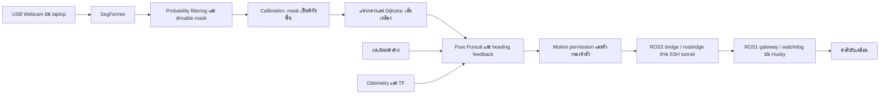

# Husky A200 — Camera Steering Assist

**ระบบตรวจจับพื้นที่ขับเคลื่อนและช่วยควบคุมทิศทางจากภาพกล้อง**

Branch สำหรับอ่านประกอบรายงาน/ส่งอาจารย์ คัดจากรุ่นล่าสุด `7ae63a1` ของ `experiment/local-ai-lidar` เมื่อ 4 พฤศจิกายน 2569 และจัดไฟล์ให้เหลือระบบที่ใช้อยู่ในปัจจุบัน

ผู้ใช้กดเดินหน้าค้างบน keyboard teleop ระบบตรวจพื้นที่จากภาพและช่วยเลี้ยวหุ่นให้เข้าแนวกลางทาง ปล่อยปุ่มแล้วหยุด ไม่มีการปัก goal หรือวิ่งไปจุดหมายโดยอัตโนมัติ

## ลำดับการทำงาน

- **Laptop:** Ubuntu / ROS 2 Jazzy, Cyclone DDS, กล้อง, SegFormer, planner, controller
- **Husky:** ROS 1 Noetic, base driver/odometry, operator console, gateway
- **สีเขียว:** mask ที่ระบบจำแนกว่าเป็นพื้นที่ขับได้
- **สีเหลือง:** reference ที่ผ่านการตรวจพื้นที่สำหรับ controller
- **สีน้ำเงิน:** แกนหุ่น `Y=0` ฉายตาม calibration และตำแหน่งกล้อง ไม่จำเป็นต้องตรงกลางภาพ

## อ่านโค้ดส่วนไหน

| ส่วน | ไฟล์หลัก |
|---|---|
| โหลดโมเดลและ inference | [road_navigation/segmentation.py](road_navigation/segmentation.py) |
| กรอง mask, optical flow, hysteresis, ช่องเล็ก | [road_navigation/detector.py](road_navigation/detector.py) |
| ตัวกรองสีพืช | [road_navigation/vegetation.py](road_navigation/vegetation.py) |
| รับภาพและรัน inference ใน ROS 2 | [husky_drivable_area/nodes.py](husky_drivable_area/nodes.py) |
| พิกัดพื้นและตำแหน่งกล้อง | [ground_geometry.py](husky_drivable_area/ground_geometry.py), [assist_geometry.py](husky_drivable_area/assist_geometry.py) |
| หาแนวกลางและทางต่อใน mask | [area_reference.py](husky_drivable_area/area_reference.py) |
| Pure Pursuit | [control.py](husky_drivable_area/control.py) |
| วงรอบควบคุม, heading feedback, reference hold | [camera_assist_node.py](husky_drivable_area/camera_assist_node.py), [reference_stability.py](husky_drivable_area/reference_stability.py) |
| วาดเส้นเหลือง/น้ำเงิน | [assist_overlay.py](husky_drivable_area/assist_overlay.py) |
| กดเดินหน้าค้าง | [assist_teleop.py](husky_drivable_area/assist_teleop.py) |
| กรองคำสั่งและตรวจ permission | [safety_node.py](husky_drivable_area/safety_node.py) |
| เชื่อม ROS 2–ROS 1 | [robot_bridge_node.py](husky_drivable_area/robot_bridge_node.py), [robot_link.py](husky_drivable_area/robot_link.py) |
| Watchdog และ budget ของ session | [husky_link_core](husky_link_core) |
| Gateway และ console บนหุ่น | [ros1/husky_vision_bridge](ros1/husky_vision_bridge) |
| เปิดระบบ | [camera_assist.launch.py](launch/camera_assist.launch.py) |
| เตรียมข้อมูล/เทรน | [tools/prepare_cvat_dataset.py](tools/prepare_cvat_dataset.py), [tools/train_segmentation.py](tools/train_segmentation.py) |

## ค่าที่กำหนดในรุ่นล่าสุด

| รายการ | ค่า |
|---|---:|
| ความเร็วเดินหน้าสูงสุดเมื่อใช้โปรไฟล์ 035 | 0.35 m/s |
| ความเร็วเชิงมุมสูงสุด | 0.15 rad/s |
| Pursuit lookahead | 0.35 m |
| Grid ของ planner | 0.05 m |
| อายุ reference สูงสุด | 2 s จาก capture เดิม |
| เพดานความเร็ว reference เก่าเกิน 0.5 s / held reference | 0.08 m/s |
| Session | สูงสุด 900 s, 100 m, มุมสะสม 2π |
| Model input ใน camera-assist launch | 256 × 160 |

ค่าข้างต้นเป็นการตั้งค่า ไม่ใช่ผลวัดความเร็ว/ความแม่นยำของการทดลอง ความเร็วจริงลดได้เมื่อเลี้ยวหรือแก้แนว ระบบใช้ odometry/TF จริง แม้ไม่ใช้แผนที่หรือ LiDAR เพื่อวางเส้นทาง

## เอกสาร

- [อัลกอริทึมและขอบเขตของระบบ](docs/ALGORITHMS.md)
- [เตรียม workspace และรันทุก terminal](docs/RUN.md)
- [ข้อมูลและการเทรน SegFormer](docs/TRAINING.md)
- [ที่มาของโค้ดและรายการจัดระเบียบ](docs/SOURCE_MAP.md)

## ไฟล์ที่ต้องมีเพิ่มเติมสำหรับรัน

Git branch นี้มี source code และ configuration ตัวอย่าง **ไม่มีน้ำหนัก SegFormer ที่เทรนแล้ว, dataset จริง, calibration/mount ที่วัดจากกล้องจริง หรือ robot profile ของเครื่องทดลอง** เพราะไฟล์เหล่านั้นอยู่ใน workspace ของผู้จัดทำ ไม่ได้อยู่ใน Git ต้นทาง

ผู้จัดทำสามารถใช้ไฟล์จริงจาก `~/husky_vision_ws` กับ source ชุดนี้ได้ตาม [RUN.md](docs/RUN.md) ผู้ที่ clone เพื่ออ่านโค้ดไม่จำเป็นต้องมี ROS หรือหุ่นยนต์ แต่การรันระบบต้องเตรียม dependencies และไฟล์จริงข้างต้นก่อน ค่า `null` ในตัวอย่างเป็นข้อมูลที่ต้องกรอก ไม่ใช่ค่าพร้อมสั่งหุ่นเคลื่อนที่

Branch นี้คงประวัติ Git เดิมไว้เพื่ออ้างอิง แต่หน้าไฟล์ปัจจุบันตัดส่วนทดลองเก่าออก การจัดชุดนี้ตรวจทานโค้ด/การอ้างอิงไฟล์เท่านั้น ไม่ได้รัน unit tests, simulation, inference หรือทดลองบนหุ่นซ้ำตามคำขอผู้จัดทำ
