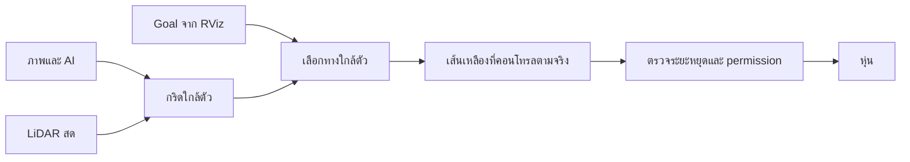

# ทดลอง goal + ภาพ AI + LiDAR ใกล้ตัว โดยไม่รอ global plan

โหมดทดลอง `guidance_mode:=local_fusion` อยู่ใน branch `experiment/local-ai-lidar`
ชุดเดิมอยู่ที่ commit `7eb83b3` และยังเป็นค่า default `guidance_mode:=global_route`

## เปลี่ยนอะไร

RViz ส่งพิกัด goal ให้ตัวสร้างเส้นเหลืองโดยตรง โหมดนี้ไม่เปิด planner_server
ไม่เรียก ComputePathToPose และไม่ต้องได้ goal_plan ก่อนสร้างเส้นเหลือง
ยังใช้ map และ AMCL/TF เพื่อระบุตำแหน่ง goal เทียบกับหุ่น



- เซลล์ที่ใช้สร้างทางต้องมีทั้ง image label ว่าผ่านได้และ finite LiDAR ray รองรับ
- จุด LiDAR หรือ image veto ขวางทางได้ ช่องไม่มี return และภาพนอกมุมมองยังเป็น unknown
- ใช้ candidate curves เดิมเลือกทางตาม goal แต่เพิ่มการตรวจสี่เหลี่ยมตัวหุ่นตลอดส่วนเส้นทางที่มองเห็น
  ส่วนจากตัวหุ่นตรวจด้วยระยะหยุดของคำสั่งจริงหลัง limiter รวมความเร็วที่วัดจาก odometry
  ไม่สร้างเส้นเชื่อมข้ามเขตบอดของกล้องเพื่ออ้างว่าเห็นทางแล้ว
- ตรวจ LiDAR สดไม่เกิน 0.3s และภาพไม่เกิน 0.5s พร้อม TF ณ timestamp ต้นฉบับ
  การเปิด supervised trial ไม่ข้าม local LiDAR checks เหล่านี้
- สร้างกริดจาก scan แต่ละเฟรมในพิกัดหุ่นตอนบันทึก ไม่สะสมกรอบใน global map
  เมื่อ return หาย บริเวณนั้นเป็น unknown จนมี finite ray ใหม่รองรับ ไม่ใช้ timeout ลบทิ้งเป็นทางว่าง
- เพิ่ม `/husky_nav/local_fusion_grid` ให้ RViz และยังใช้เส้นเดียวกับ controller ใน
  `/husky_nav/vision_reference` และ `/husky_nav/vision_overlay/compressed`

## 1. ลองในคอมตอนนี้ โดยไม่ต้องมีหุ่นหรือ ROS

ครั้งแรก ดึง branch ทดลองและสร้าง environment แยกจาก AI เดิม:

```bash
cd ~/husk-live
git fetch origin
git switch experiment/local-ai-lidar
python3 -m venv .venv-local-demo
.venv-local-demo/bin/python -m pip install -r requirements-local-fusion-demo.txt
.venv-local-demo/bin/python tools/demo_local_fusion.py \
  --output-dir outputs/local-fusion-home-01
xdg-open outputs/local-fusion-home-01/local-fusion-demo.png
```

รันซ้ำให้เปลี่ยนชื่อ output directory ใหม่ ผลมีภาพเปรียบเทียบ ทางตรง/อ้อมวัตถุ/unknown
พร้อม `report.json` และ trajectory ของการเดินจำลองไป goal ระยะ 2m
ทุกอย่างใน demo เป็นข้อมูลจำลอง ไม่มีการ publish คำสั่งหรือโหลดโมเดล AI จริง
ไม่ใช้ภาพใน demo อ้างว่าได้ทดสอบกับหุ่นแล้ว

## 2. เตรียม workspace สำหรับกล้องและหุ่นจริง

ทำบนคอมได้ตอนที่ไม่มีหุ่น โดยใช้ workspace/profile เดิม:

```bash
cd ~/husk-live
python3 tools/create_ros2_workspace.py \
  --workspace "$HOME/husky_vision_ws" --update-code --with-navigation
source /opt/ros/jazzy/setup.bash
source "$HOME/husky_vision_ws/.venv/bin/activate"
cd ~/husky_vision_ws
python /usr/bin/colcon build --symlink-install \
  --packages-select husky_vision_nav2 husky_vision
source install/local_setup.bash
export RMW_IMPLEMENTATION=rmw_cyclonedds_cpp
```

export สำรอง source เดิมก่อนเขียน และคง robot profiles, โมเดล และ calibration ไว้
การแก้โหมดนี้อยู่ฝั่งคอม ROS2 ใช้ ROS1 gateway/operator console และ tunnel เดิม

## 3. เมื่อได้หุ่น เริ่มด้วย preview

ปิด field launch เดิมก่อนสลับโหมด เปิด bridge/tunnel ตามชุดเดิม
แล้วเปิดคอมโดยเพิ่ม `guidance_mode:=local_fusion`:

```bash
QT_QPA_PLATFORM=xcb ros2 launch husky_vision vision_field.launch.py \
  profile:="$HOME/husky_vision_ws/robot/robot-nojoy-015.json" \
  map:="$HOME/husky_vision_ws/maps/outdoor1.yaml" \
  guidance_mode:=local_fusion \
  supervised_trial:=true \
  allow_motion:=false
```

ตัวอย่างใช้ profile ทดลอง 0.15m/s เดิม ถ้าใช้ profile คนละตัว ให้คงค่า supervised_trial
ให้ตรงกับ profile เหมือนชุดเดิม การเพิ่ม guidance_mode ไม่เปลี่ยนความเร็ว/ระยะ/เวลา

เปิดภาพจากอีก terminal ที่ source environment และตั้ง Cyclone เหมือนกัน:

```bash
QT_QPA_PLATFORM=xcb ros2 run image_view image_view --ros-args \
  -r image:=/husky_nav/vision_overlay -p image_transport:=compressed
```

ตั้ง 2D Pose Estimate ให้ตรงตำแหน่งก่อน แล้วปัก goal ด้านหน้าหุ่น
หน้าภาพขึ้น `LOCAL AI + LiDAR` และเส้นเหลืองจะเกิดเมื่อข้อมูลใกล้ตัวรองรับทาง
goal_status ควรเป็น `local_goal_ready`; ไม่ต้องรอ `image_guidance_ready` ของ Nav2
allow_motion=false ยังคงปิดทางส่งคำสั่งเข้าหุ่นแม้ private controller จะคำนวณเส้นและความเร็วได้
เส้นเหลืองอาจแสดง reference ด้านหน้าที่มองเห็นได้ แต่คำสั่งยังเป็นศูนย์ถ้าเขตบอดใกล้ตัวไม่ผ่าน stop sweep

อ่านเหตุที่สร้างทางหรือเคลื่อนไม่ได้:

```bash
ros2 topic echo /husky_nav/vision_control_status --once --full-length
```

`map_use` ของโหมดใหม่เป็น `goal_position_only`
ตรวจว่าโหลดโหมดใหม่จริงได้ด้วย `ros2 param get /vision_goal_controller guidance_mode`
ซึ่งต้องได้ `local_fusion`
เหตุ `local_lidar_missing/stale`, `local_lidar_stop_sweep_blocked_or_unknown`
หรือ `local_fusion:...` หมายถึง local evidence/ขนาดตัวหุ่นยังไม่ผ่าน
ไม่ใช้การ clear global costmap เพื่อแก้เหตุเหล่านี้
การเปิด motion ภายหลังยังต้องใช้ allow_motion และ reset/enable/operator session เดิมทุกชั้น
limit เดิมยังมีผล รวมเพดานการหมุนสะสมของ trial; การสร้างทางอ้อมได้ไม่ได้ยกเลิกเพดานนี้

## ขอบเขตที่ต้องรู้ก่อนทดลองจริง

นี่เป็นข้อ1: local fusion ของภาพกับ **LaserScan ระนาบเดิม** ยังไม่ได้ทำข้อ2ที่ใช้ cloud 3D
scan วงเดียวของ VLP16 ไม่รับรองวัตถุเตี้ย พื้น ขอบตก หรือ overhang
การ sampling สี่เหลี่ยมเป็นแบบจำลองในระนาบ scan ไม่ใช่ physical safety certification
status จึงยังรายงาน height coverage และ deskew ว่ายังไม่ผ่าน validation

ค่า `lidar_min_range_m` ของ node/launch เป็น 0.4m ตาม `min_range` ที่เคยอ่านจากต้นทาง VLP16
แม้ LaserScan ของหุ่นรายงาน range_min=0 จะไม่ใช้ศูนย์นั้นเติมเขตบอดให้เป็นทางว่าง
ค่าอ่านจาก `robot.local_scan_min_range_m` ได้เมื่อตั้งใน profile ตามข้อมูลติดตั้งจริง
ถ้าเขตบอดนอกตัวหุ่นทับบริเวณที่ต้องตรวจ โหมดนี้จะหยุด ต้องแก้ coverage/ติดตั้งเซนเซอร์
หรือพัฒนาส่วน 3D ต่อ การลดค่าตามภาพที่ดูโล่งไม่ได้เพิ่มข้อมูลที่เซนเซอร์มองเห็น
sensor ใน demo/native fixture เป็นแบบจำลองที่เห็นจาก 0.1m จึงไม่ใช่ผลยืนยัน coverage ของหุ่นจริง

โหมดนี้เหมาะกับ goal ด้านหน้าและทางเดินต่อเนื่อง ไม่มีการหมุนกลับ/ถอยหรือแก้ทางตันระดับอาคาร
ไม่มีการสร้างทางผ่าน image veto/unknown เพื่อฝืนไปถึง goal และจุดผิดที่ยังส่งมาสดก็ยังขวางทางได้
การทดสอบในคอมไม่ยืนยันว่าจะเดินถึง goal จริง 100m

## ผลทดสอบของชุดนี้

- Unit tests 409 cases ผ่าน
- Native ROS2: ไม่มี global planner/action client, ส่ง empty global route มาก็ไม่ล้าง reference ใหม่,
  เส้นในภาพตรงกับ controller/capture, หยุดเมื่อมีวัตถุใกล้/LiDAR ขาดหรือ unknown/ภาพ veto หรือเก่า/ยกเลิก goal
  และถึง goal จำลอง 2m ภายใน tolerance 0.15m โดย gate ฝั่ง preview ยังคงเป็นศูนย์
- Native โหมด global_route เดิมยังผ่านการทดสอบถึง goal จำลอง พร้อม TF ล่าช้า 90ms
- อ่าน geometry ของ scan จริงใน `husky-ghost-20261030-050159.bag` ได้ครบ 34 เฟรม
  แต่เมื่อใช้ min_range=0.4m ตามต้นทาง **ทั้ง34เฟรมยังไม่ผ่านการรองรับ footprint ปัจจุบัน**
  และจุดทดสอบท้ายหุ่นที่ X=-0.60m ยังเป็น unknown ทุกเฟรม ข้อมูลนี้จึงยังใช้เปิดเดินโหมดใหม่ไม่ได้
  ต้องเริ่ม preview และแก้/ยืนยัน coverage ใกล้ตัวเมื่อได้หุ่น ไม่มีภาพกล้องใน bag นี้ให้ทดสอบ fusion จริง

ผล native/demo ใช้ภาพและ sensor แบบจำลองซึ่งระยะต่ำสุด 0.1m
จึงใช้ยืนยัน software behavior เท่านั้น ไม่ใช่ผลวิ่งของ VLP16 บนหุ่นจริง

## กลับไปชุดเดิม

เปิด field launch ใหม่ด้วย `guidance_mode:=global_route` หรือไม่ระบุ argument นี้
ถ้าต้องการ source เดิมทั้งชุดใช้ branch `work` ที่ commit `7eb83b3` แล้ว export/build ใหม่
