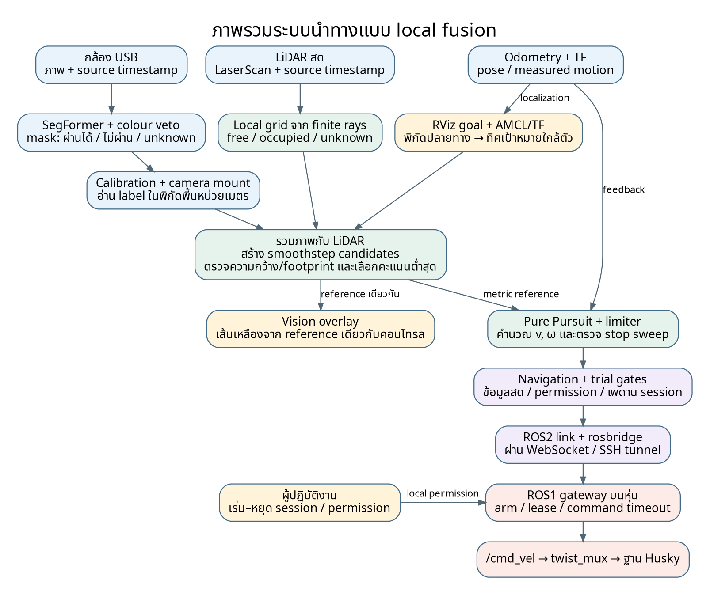
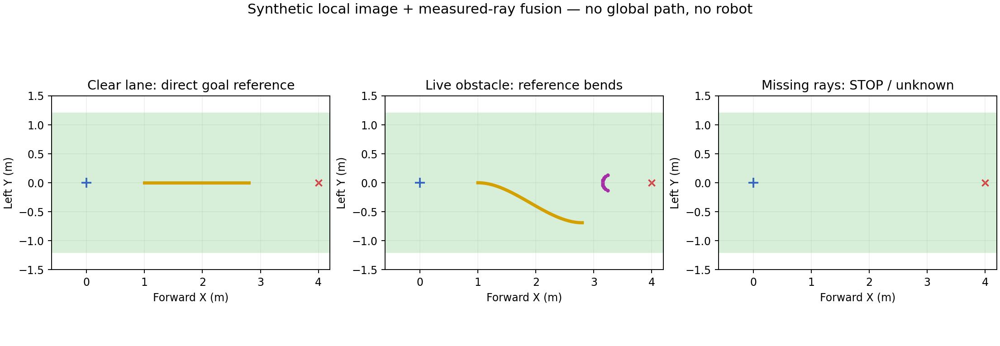
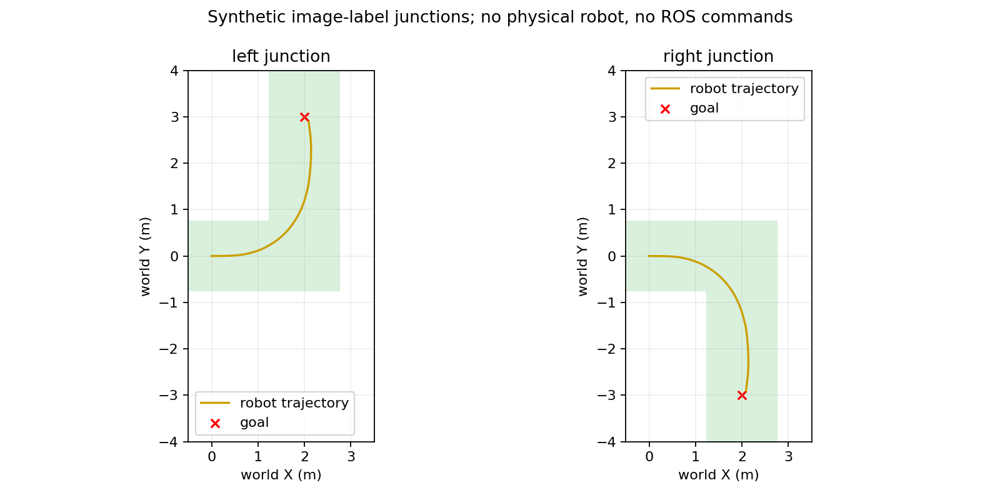

# การพัฒนาระบบนำทางหุ่นยนต์ Husky ด้วยภาพกล้อง ปัญญาประดิษฐ์ และข้อมูล LiDAR

## การสร้างเส้นทางใกล้ตัวและการควบคุมการเคลื่อนที่ไปยังเป้าหมายภายใต้การกำกับของผู้ปฏิบัติงาน

**ชื่อภาษาอังกฤษ:** Image-Based Local Navigation and Goal-Directed Control of a Husky Robot Using Semantic Segmentation and Live LiDAR

**ผู้จัดทำ:** ............................................................  
**สาขาวิชา/หน่วยงาน:** ............................................................  
**วันที่ปรับปรุง:** 2 พฤศจิกายน 2569

**ขอบเขตซอฟต์แวร์ที่อธิบาย:** branch `experiment/local-ai-lidar`; local fusion จาก `a426335` และส่วนขยาย `image_only` วันที่ 2 พฤศจิกายน 2569

**สถานะ:** ระบบต้นแบบที่มีการทดสอบซอฟต์แวร์ การจำลอง และข้อมูลบันทึกจากหุ่นบางส่วน

**โหมดที่เพิ่มล่าสุด:** `image_only` สร้าง reference จากภาพและ AI โดยรับ goal โดยตรง และไม่ใช้ LiDAR ยับยั้งคำสั่งจากสิ่งกีดขวาง รายละเอียดอยู่ในภาคผนวก ค ส่วน `local_fusion` ยังคงเป็นอีกโหมดที่เลือกใช้ได้และยังตรวจ LiDAR ตามเดิม

## บทคัดย่อ

โครงงานนี้พัฒนาระบบนำทางสำหรับหุ่นยนต์เคลื่อนที่ Husky โดยให้ภาพจากกล้องและผลการจำแนกพื้นที่ด้วยปัญญาประดิษฐ์เป็นข้อมูลหลักในการเลือกแนวการเคลื่อนที่ ผู้ปฏิบัติงานกำหนดพิกัดปลายทางผ่าน RViz จากนั้นระบบสร้างเส้นทางอ้างอิงระยะใกล้จากบริเวณที่ภาพระบุว่าขับผ่านได้ และคำนวณความเร็วเดินหน้าและความเร็วเชิงมุมเพื่อให้หุ่นติดตามเส้นทางดังกล่าวโดยอัตโนมัติ การเลี้ยวระหว่างการทำงานจึงมาจากตัวควบคุม ไม่ต้องบังคับทิศทางด้วย joystick ตลอดเวลา

ระบบใช้ SegFormer สำหรับจำแนกภาพเป็นพื้นที่ที่คาดว่าขับผ่านได้และพื้นที่อื่น ร่วมกับกฎยับยั้งบริเวณที่มีลักษณะสีเขียวของพืชพรรณ จากนั้นใช้ค่าปรับเทียบกล้องและตำแหน่งติดตั้งแปลงความสัมพันธ์ระหว่างพิกเซลกับระนาบพื้น เพื่อประเมินทางในหน่วยเมตรแทนการอาศัยความกว้างบนภาพเพียงอย่างเดียว โหมด local fusion รวมข้อมูลภาพเข้ากับ LaserScan สดจาก LiDAR โดยแยกพื้นที่เป็นผ่านได้ ถูกกีดขวาง และยังไม่มีหลักฐานเพียงพอ ส่วนโหมด image only ที่เพิ่มภายหลังใช้ภาพสร้าง reference โดยไม่ใช้การตรวจสิ่งกีดขวาง LiDAR ยับยั้งคำสั่ง ภายใต้การกำกับของผู้ปฏิบัติงาน

อัลกอริทึมเลือกทางสร้างเส้นโค้งผู้สมัครแบบ smoothstep ตรวจความต่อเนื่อง ความกว้าง ความโค้ง และขนาดตัวหุ่น ก่อนเลือกทางด้วยคะแนนที่พิจารณาระยะห่างจากขอบทาง ทิศทางเป้าหมาย และความโค้ง ใช้ Pure Pursuit แปลงเส้นทางที่เลือกเป็นคำสั่งความเร็ว และตรวจบริเวณที่ตัวหุ่นจะกวาดผ่านระหว่างตอบสนองและหยุด ระบบส่งคำสั่งผ่านชั้นอนุญาตการเคลื่อนที่ ตัวจำกัดการทดลอง และ gateway บนหุ่นซึ่งตรวจอายุคำสั่งและสถานะ session

โหมด local fusion และ image only ลดการพึ่งพา global plan ซึ่งเคยขัดขวางการสร้างทางแม้ภาพแสดงพื้นที่โล่ง ผลการทดสอบซอฟต์แวร์ผ่าน 438 กรณี การทดสอบ ROS2 ด้วยข้อมูลจำลองของทั้งสองโหมดสามารถเคลื่อนถึงเป้าหมายระยะ 2 เมตรภายในเกณฑ์คลาดเคลื่อน 0.15 เมตร โดย local fusion หยุดเมื่อพบจุด LiDAR ใกล้ตัว ส่วน image only ยังคงมีคำสั่งเดินในกรณีนั้นตามวัตถุประสงค์ของโหมด อย่างไรก็ตาม ผลดังกล่าวเป็นหลักฐานด้านพฤติกรรมซอฟต์แวร์ ยังไม่ใช่การยืนยันความสำเร็จในการเดินทางจริงระยะ 100 เมตร หรือการรับรองความปลอดภัยของระบบทั้งหมด

**คำสำคัญ:** หุ่นยนต์เคลื่อนที่, การนำทางด้วยภาพ, Semantic Segmentation, SegFormer, Local Planning, LiDAR, Pure Pursuit, ROS

## 1. ที่มาและปัญหาของงาน

การนำทางหุ่นยนต์ในทางเดินจริงต้องตอบคำถามสองส่วน คือ “ต้องไปที่ใด” และ “ขณะนี้ควรเคลื่อนที่ผ่านบริเวณใด” พิกัดเป้าหมายเพียงอย่างเดียวไม่เพียงพอสำหรับเลือกทาง เพราะสภาพพื้น ทางเดิน และวัตถุรอบตัวอาจเปลี่ยนแปลงไปจากแผนที่ที่บันทึกไว้ งานนี้จึงใช้แผนที่และการระบุตำแหน่งสำหรับอ้างอิงปลายทาง ส่วนการเลือกแนวการเคลื่อนที่ระยะใกล้อาศัยภาพปัจจุบันเป็นหลัก

ระหว่างการพัฒนาพบว่า global costmap อาจมีบริเวณต้นทุนสูงหรือวงขยายรอบจุดสิ่งกีดขวาง ซึ่งใน RViz ปรากฏเป็นพื้นที่สีฟ้าหรือสีอื่นตามรูปแบบการแสดงผล เมื่อบริเวณดังกล่าวขวางตำแหน่งเริ่มต้นหรือทางไปเป้าหมาย global planner อาจสร้างทางอ้อมมาก หรือคืนสถานะ `NO_VALID_PATH` ส่งผลให้ไม่มีเส้นทางสำหรับเริ่มคอนโทรล แม้ผู้ปฏิบัติงานมองเห็นทางเดินโล่งในภาพกล้อง

สีที่แสดงบน costmap ไม่ใช่ผลการจำแนกวัตถุทางกายภาพโดยตรง แต่เป็นการแสดงค่าจากชั้นแผนที่ สิ่งกีดขวาง และ inflation หลายชั้น จึงไม่สามารถสรุปจากสีเพียงอย่างเดียวว่ามีวัตถุจริง หรือว่าวงทั้งหมดเป็นข้อมูลผิด สาเหตุที่พิจารณาในงานนี้ประกอบด้วยการสะสมจุดในกรอบพิกัด การเปลี่ยนตำแหน่งจาก localization ความไม่ครบถ้วนของข้อมูลใกล้ตัว และข้อจำกัดของการแปลงข้อมูลเซนเซอร์เป็นกริด

แนวทางพัฒนาจึงมีทั้งการปรับการจัดเก็บสิ่งกีดขวางของชุดเดิม และการเพิ่มโหมดทดลองที่ส่ง goal ให้ตัววางแผนใกล้ตัวโดยตรง พร้อมคงการตรวจสิ่งกีดขวางสดจาก LiDAR ไว้

## 2. วัตถุประสงค์และขอบเขต

วัตถุประสงค์ของโครงงานมีดังนี้

1. ตรวจจับพื้นที่ที่มีลักษณะเหมาะกับการขับผ่านจากภาพกล้องด้วยโมเดล semantic segmentation
2. สร้างเส้นทางอ้างอิงในหน่วยเมตร โดยคำนึงถึงทิศทางเป้าหมาย ขนาดหุ่น และข้อมูลสิ่งกีดขวางปัจจุบัน
3. ควบคุมความเร็วเดินหน้าและการเลี้ยวให้ติดตามเส้นทางจากภาพโดยอัตโนมัติ
4. แยกการเลือกทางออกจากการอนุญาตให้เคลื่อนที่ เพื่อให้หยุดเมื่อข้อมูลเก่าหรือการสื่อสารขาดหาย
5. ตรวจสอบการทำงานด้วย unit tests การจำลอง ROS2 และข้อมูลที่บันทึกจากหุ่น ก่อนนำไปทดสอบภาคสนามเพิ่มเติม

ระบบต้นแบบเน้น goal ที่อยู่ด้านหน้าและทางเดินที่ต่อเนื่อง ไม่ได้ออกแบบให้แก้ทางตันระดับอาคาร ถอยหลัง หรือหมุนกลับอัตโนมัติครบทุกกรณี การฉายภาพลงพื้นใช้สมมติฐานระนาบพื้น ส่วนข้อมูล LiDAR ที่ใช้เลือกทางในโหมดล่าสุดเป็น LaserScan สองมิติ ไม่ใช่อัลกอริทึมแยกพื้นจาก point cloud สามมิติ

คำว่า “อัตโนมัติ” ในรายงานนี้หมายถึงการเลือกแนวทางและคำนวณคำสั่งเดิน/เลี้ยวหลังได้รับอนุญาตให้เริ่ม ผู้ปฏิบัติงานยังทำหน้าที่เลือก goal เริ่มหรือหยุด session และกำกับการทดลอง

## 3. องค์ประกอบฮาร์ดแวร์และซอฟต์แวร์

| องค์ประกอบ | หน้าที่และข้อมูลที่ใช้ในงาน |
|---|---|
| หุ่นยนต์ Husky A200 | รับคำสั่งความเร็วเชิงเส้นและเชิงมุมผ่านระบบ ROS1 บนหุ่น |
| กล้อง USB | ส่งภาพสีด้านหน้าหุ่น ขนาด capture ที่ใช้ในบันทึกการทดลอง 640 × 480 พิกเซล และอัตราเป้าหมายประมาณ 15 เฟรม/วินาที |
| Velodyne VLP16 | ให้ข้อมูลสภาพแวดล้อม โดยระบบ local fusion ใช้ LaserScan ที่สร้างจากต้นทาง LiDAR |
| Odometry | ให้ตำแหน่ง ทิศทาง และความเร็วที่วัดได้สำหรับการติดตามทางและตรวจระยะการทดลอง |
| คอมพิวเตอร์ประมวลผล | Intel Core i5-12500H, RAM ประมาณ 16 GB และ NVIDIA GeForce RTX 3050 Mobile หน่วยความจำ GPU 4 GB ตามข้อมูลเครื่องที่ผู้ทดสอบส่งมา |
| ROS1 Noetic | ทำงานบนหุ่น จัดการ gateway, operator console และการส่งคำสั่งเข้าฐาน |
| ROS2 Jazzy | ทำงานบนคอมพิวเตอร์ จัดการกล้อง AI การระบุตำแหน่ง การสร้างทาง และตัวควบคุม |
| PyTorch และ Transformers | โหลดและประมวลผลโมเดล SegFormer แบบ local |
| OpenCV และ NumPy | ประมวลผลภาพ การฉายพิกัด การสร้างกริด และการคำนวณเรขาคณิต |
| Nav2 map server, AMCL และ TF2 | โหลดแผนที่ ระบุตำแหน่งหุ่น และแปลงพิกัด goal/ข้อมูลเซนเซอร์ |
| rosbridge/WebSocket | เชื่อมข้อมูลและคำสั่งระหว่าง ROS1 กับ ROS2; การใช้งานที่บันทึกไว้มีการเชื่อมผ่าน SSH tunnel |
| RViz และ image viewer | ใช้กำหนด pose/goal ตรวจสถานะ และแสดงภาพกับเส้นทางอ้างอิง |

ข้อมูลขนาดหุ่นและ margin อ่านจาก robot profile จริง ไม่ผูกไว้กับขนาดบนจอ ตัวอย่างค่าที่ใช้ในโค้ดเรขาคณิตคือระยะหน้าจาก base 0.50 เมตร ระยะหลัง 0.56 เมตร และครึ่งความกว้าง 0.33 เมตร ส่วน margin สามารถกำหนดใน profile ตามการติดตั้งและการตรวจวัดของชุดนั้น

## 4. สถาปัตยกรรมและลำดับข้อมูลของระบบ



ภาพที่ 1 แสดงเส้นทางข้อมูลหลักในโหมดทดลองล่าสุด กล้องและ AI ให้หลักฐานด้านลักษณะพื้นผิว LiDAR ให้หลักฐานสิ่งกีดขวางในระนาบ scan ส่วน goal และ TF บอกทิศทางที่ควรมุ่งไป เมื่อตัวสร้างทางเลือกเส้นอ้างอิงแล้ว ตัวควบคุมจึงคำนวณความเร็ว จากนั้นผ่านการตรวจระยะหยุดและเงื่อนไขอนุญาตก่อนส่งถึงฐานหุ่น

ขั้นตอนการทำงานในหนึ่งรอบประกอบด้วยการรับภาพล่าสุด ประมวลผล segmentation จับคู่ผลกับ timestamp ของภาพ แปลงข้อมูลเข้าสู่กรอบพิกัดที่สัมพันธ์กัน สร้างและประเมินทางผู้สมัคร คำนวณคำสั่งติดตามทาง และตรวจเงื่อนไขก่อนส่งคำสั่ง ขั้นตอนนี้ทำซ้ำเมื่อมีข้อมูลใหม่ จึงเป็นการวางแผนระยะใกล้ซ้ำระหว่างเคลื่อนที่ ไม่ได้สร้างเส้นเดียวจากต้นทางถึงปลายทางแล้วใช้โดยไม่ปรับปรุง

ระบบแยกหน้าที่ระหว่างสองเครื่อง โดยคอมพิวเตอร์ทำงานที่ใช้ทรัพยากรสูง เช่น AI และการเลือกทาง ขณะที่หุ่นมี gateway ตรวจคำสั่งและการอนุญาตในเครื่องของตนเอง การแยกเช่นนี้ทำให้การสูญเสียการเชื่อมต่อไม่ควรถูกตีความเป็นการอนุญาตให้ใช้คำสั่งเดิมต่อไปโดยไม่มีกำหนด

### 4.1 โหมดการนำทางที่เลือกใช้ได้

| ประเด็น | `global_route` | `local_fusion` |
|---|---|---|
| สถานะในซอฟต์แวร์ | ชุดเดิมและค่าเริ่มต้น | โหมดทดลองที่เพิ่มขึ้น |
| บทบาทของ global planner | สร้างเส้นทางคร่าว ๆ เพื่อชี้ทิศทางหรือกิ่งทาง | ไม่ต้องสร้าง global plan ก่อน |
| เงื่อนไขเริ่มสร้างเส้นอ้างอิง | ต้องมี goal และ route guide ที่ใช้ได้ | ต้องมี goal และข้อมูลภาพ/LiDAR/TF ที่ใช้ได้ |
| การใช้ map | ตำแหน่งและ route guidance | ตำแหน่ง goal และ localization |
| การเลือกแนวคอนโทรลจริง | สร้างจากภาพ โดย route ให้ทิศทาง | สร้างจากภาพร่วมกับ LaserScan สด |
| ผลของ global `NO_VALID_PATH` | อาจทำให้ไม่มี goal guide | ไม่เป็นเงื่อนไขที่ต้องรอ |

อีกโหมดคือ `image_only` ซึ่งเหมือน local fusion ในส่วนการรับ goal โดยตรง แต่ไม่รวม scan เข้ากับ mask และไม่ตรวจ LiDAR footprint/stop sweep ก่อนออกคำสั่ง ตัวสร้างทางใช้เฉพาะหลักฐานภาพกับทิศเป้าหมาย ส่วน localization และ permission ยังทำงานตามเดิม

เนื้อหาการรวมข้อมูลและตรวจ LiDAR ในรายงานนี้อธิบายเฉพาะ `local_fusion` รายละเอียดของ `image_only` อยู่ในภาคผนวก ค การเพิ่มโหมดไม่ได้เปลี่ยนค่าเริ่มต้นของทุก launch; ค่าเริ่มต้นยังเป็น `global_route`

## 5. การรับภาพและการจำแนกพื้นที่ด้วย AI

### 5.1 การเลือกใช้ภาพล่าสุด

งานคอนโทรลต้องการสภาพแวดล้อมที่ใกล้ปัจจุบันมากกว่าการประมวลผลภาพเก่าครบทุกเฟรม ระบบจึงแยกการรับภาพออกจากงาน inference และใช้ช่องเก็บภาพล่าสุด เมื่อประมวลผลไม่ทันสามารถข้ามภาพที่ยังไม่ได้ใช้ แล้วเริ่มจากภาพล่าสุดแทนการสะสมคิวภาพยาว

แนวทางนี้ลดความล่าช้าจากคิว แต่ไม่ได้รับรองว่ากล้องหรือเครือข่ายจะส่งภาพสม่ำเสมอตลอดเวลา จึงต้องตรวจทั้งอายุภาพและช่วงห่างระหว่างภาพที่มาจากการ capture คนละครั้ง ไม่ใช้ FPS เฉลี่ยเพียงค่าเดียวตัดสินความพร้อมของระบบ

### 5.2 การประมวลผล SegFormer

SegFormer เป็นโมเดล semantic segmentation ที่มี encoder แบบ Transformer และ decoder สำหรับสร้างผลจำแนกรายพิกเซล งานนี้นำโครงสร้างที่มีอยู่มาใช้ ไม่ได้ออกแบบสถาปัตยกรรม neural network ใหม่

โมดูล inference โหลดโมเดลจากโฟลเดอร์ในเครื่อง ตรวจ class mapping ให้มี 2 คลาส คือ `0 = non_drivable` และ `1 = drivable` แปลงภาพ BGR เป็น RGB และเตรียม tensor ตาม image processor ของโมเดล ใน field launch ปัจจุบันกำหนดขนาด input ของโมเดล 256 × 160 พิกเซล ประมวลผลบน CUDA และกำหนด PyTorch CPU threads เท่ากับ 2 ส่วนผล logits ถูกขยายกลับให้สัมพันธ์กับขนาดภาพ capture ก่อนใช้งานต่อ

ให้ z₀(u,v) และ z₁(u,v) เป็น logits ของสองคลาส ความน่าจะเป็นของคลาส drivable คำนวณด้วย softmax ดังนี้

```text
Pdrivable(u,v) = exp(z1(u,v)) / [exp(z0(u,v)) + exp(z1(u,v))]       (1)
```

ภาพผ่านการ threshold เพื่อสร้าง mask โดยค่าตั้งต้นของ detector คือ threshold 0.62 และ current probability floor 0.50 ในโหมด fast ปัจจุบันปิด temporal filtering จึงไม่มีการนำ mask เก่ามาเฉลี่ยเพื่อเปิดพื้นที่ที่ภาพปัจจุบันไม่รองรับ

ส่วนบนของภาพเหนือขอบเขตการวิเคราะห์ถูกกำหนดเป็น unknown สำหรับ packet ที่ส่งต่อ ไม่ตีความท้องฟ้าหรือพื้นที่ที่ไม่ได้วิเคราะห์ว่าเป็นทางขับ ระบบใช้ label 1 สำหรับพื้นที่ที่ AI รองรับ label 0 สำหรับพื้นที่ที่ไม่รองรับหรือถูก veto และ label 255 สำหรับพื้นที่ไม่ทราบข้อมูล

### 5.3 กฎยับยั้งสีเขียวของพืชพรรณ

เนื่องจากสนามหญ้าหรือพืชอาจถูกโมเดลรวมกับพื้นทางเดิน ระบบมี colour veto ที่ทำงานกับภาพต้นฉบับก่อนวาดสี overlay ใช้ช่วงสี HSV ร่วมกับค่า excess green ดังนี้

```text
ExcessGreen = (2G - R - B) / max(R + G + B, 1)                     (2)
```

ค่าที่ใช้ใน configuration ปัจจุบัน ได้แก่ hue 25–95 ตามสเกล OpenCV, saturation อย่างน้อย 45, value อย่างน้อย 20 และ excess green อย่างน้อย 0.08 จากนั้นพิจารณา spatial support ในบริเวณรัศมี 3 พิกเซล สัดส่วน 0.5 เพื่อคัดองค์ประกอบสีเขียวที่มีบริเวณรองรับ และขยายขอบ mask ตามค่าที่กำหนด

กฎนี้เป็นการยับยั้งจากลักษณะสี ไม่ใช่โมเดลจำแนกหญ้าโดยเฉพาะ วัตถุสีเขียวที่ไม่ใช่หญ้าอาจถูกยับยั้งได้ และสภาพแสงอาจมีผลต่อกฎ การลดสีเขียวแยกเดี่ยวใช้เฉพาะ heuristic นี้ ไม่ได้นำไปลบจุดสิ่งกีดขวาง LiDAR หรือยกเลิก semantic veto ทั้งหมด

### 5.4 ขอบเขตการรายงานเรื่องโมเดลและข้อมูลฝึก

repository มีเครื่องมือเตรียมข้อมูลภาพ/label และ fine-tune SegFormer โดยค่า base checkpoint ของสคริปต์ฝึกเป็น SegFormer-B0 ที่ผ่านการฝึกบน ADE20K มาก่อน ปรับหัวจำแนกเป็น 2 คลาส และใช้ AdamW อย่างไรก็ตาม จำนวนภาพ จำนวน epoch และ checkpoint ของโมเดลที่ใช้หน้างานต้องตรวจจาก training report ของโมเดลชุดนั้น ไม่สามารถสรุปจากสคริปต์เพียงอย่างเดียวได้

สคริปต์ฝึกปัจจุบันรายงาน training loss และระบุว่าไม่ได้ทำ independent validation ดังนั้นรายงานนี้ไม่อ้างค่า accuracy, IoU หรือ mIoU ที่ยังไม่มีผลวัดรองรับ

## 6. การปรับเทียบและแปลงภาพเป็นพิกัดพื้น

### 6.1 เหตุผลที่ต้องใช้ calibration และ mount

ความกว้าง 100 พิกเซลในระยะใกล้และไกลแทนความกว้างจริงต่างกัน หากเลือกทางจากจำนวนพิกเซลอย่างเดียว หุ่นอาจคิดว่าช่องแคบผ่านได้ หรือว่าทางจริงกว้างแต่ผ่านไม่ได้ การประเมินจึงต้องเชื่อมภาพกับหน่วยเมตรด้วยข้อมูลสองชุด

1. Camera intrinsics และ distortion ได้แก่ focal length จุดศูนย์กลางภาพ และสัมประสิทธิ์ความบิดเบี้ยวของเลนส์
2. Camera extrinsics หรือ mount ได้แก่ความสูง ตำแหน่งเยื้อง และมุม roll, pitch, yaw เทียบกับกรอบพื้นของหุ่น

ค่าติดตั้งที่ผู้ทดสอบส่งมาชุดหนึ่งมีความสูง 0.99 เมตร มุมก้มประมาณ 19.63 องศา มุม roll ประมาณ −2.05 องศา และตำแหน่ง camera x = −0.26, y = 0.21 เมตร ค่าเหล่านี้เป็นข้อมูลเฉพาะการติดตั้ง ไม่ใช่ค่ามาตรฐานที่ใช้แทนการวัดหุ่นทุกชุดได้

### 6.2 สมการฉายรังสีกล้องลงพื้น

ให้ K เป็นเมทริกซ์ intrinsics, C เป็นตำแหน่งกล้องในกรอบพื้น และ R เป็นการหมุนจาก optical frame สู่กรอบพื้น หลังแก้ distortion ของพิกเซลแล้วได้พิกัด normalized (xn, yn) รังสีในกรอบพื้นคือ

```text
dcamera = [xn, yn, 1]^T
dground = R × dcamera
P(λ) = C + λ dground                                              (3)
```

เมื่อสมมติพื้นเป็นระนาบ Z = 0 และกล้องสูง h จุดตัดได้จาก

```text
λ = -h / dground,z
Pground = C + λ dground                                            (4)
```

ใช้เฉพาะรังสีที่ชี้ลงพื้นและให้จุดตัดในช่วงที่รองรับ ส่วนรังสีใกล้เส้นขอบฟ้า รังสีที่ออกนอกภาพ หรือการฉายที่ไม่สอดคล้องกับ distortion ถูกปฏิเสธ ในตัวสร้างทางปัจจุบันสามารถเริ่มจากจุดตัวอย่างบนพื้น แล้วฉายกลับเข้าสู่ภาพเพื่ออ่าน label ได้เช่นกัน

กำหนดแกน X ชี้หน้าหุ่น Y ชี้ซ้าย และ Z ชี้ขึ้น เส้นสีน้ำเงินในภาพจึงเป็นแนว Y = 0 ของหุ่นที่ฉายผ่าน calibration ไม่จำเป็นต้องตรงกับกึ่งกลางภาพ เนื่องจากกล้องติดตั้งเยื้องหรือเอียงได้

### 6.3 การจับคู่เวลาและกรอบพิกัด

ข้อมูลภาพ ผล AI และ LiDAR ต้องมี source timestamp เพื่อทราบว่าเป็นข้อมูลจากช่วงเวลาใด ระบบใช้ TF ณ เวลาของข้อมูลต้นฉบับ แล้วจัดข้อมูลให้อยู่ในพิกัดที่สัมพันธ์กันผ่าน `odom` แทนการนำข้อมูลเก่าไปแปลงด้วย pose ปัจจุบันโดยตรง

หาก TF ของภาพยังมาไม่ทัน ระบบเก็บ capture เดิมรอและ retry ภายใน age budget เดิม โดยไม่เปลี่ยน timestamp ให้เป็นเวลาใหม่ หากมี reference ก่อนหน้าที่ยังสดสามารถใช้ได้ภายในอายุที่กำหนด แต่เมื่อหมดอายุจะหยุด วิธีนี้ช่วยลดการตัด reference จากความล่าช้าเล็กน้อยของ TF โดยไม่ซ่อนอายุจริงของภาพ

ระยะเวลารับข้อมูลในเครื่องตรวจด้วย monotonic clock ส่วนอายุ source header ตรวจด้วย ROS/system time จึงต้องซิงก์เวลาระหว่างคอมพิวเตอร์กับหุ่น ความคลาดเคลื่อนของนาฬิกาอาจทำให้ข้อมูลถูกมองว่าเก่าหรือมาจากอนาคต แม้การเชื่อมต่อยังทำงานอยู่

## 7. การสร้าง local grid จาก LiDAR และการรวมข้อมูลภาพ

### 7.1 หลักฐานจากลำแสงที่มีผลวัด

แต่ละระยะ LiDAR แปลงเป็นจุดใน sensor frame ได้จาก

```text
θi = angle_min + i × angle_increment
pi = [ri cos(θi), ri sin(θi)]                                      (5)
```

จากนั้นใช้ TF ณ เวลา scan แปลงเข้าสู่พิกัดหุ่นของ snapshot นั้น กริดต้นแบบใช้ resolution 0.05 เมตรและ extent 4.5 เมตรรอบจุดอ้างอิงแต่ละแกน

สำหรับลำแสงที่มี finite return บริเวณตามแนวรังสีก่อนถึงจุดปลายให้หลักฐาน free ในระนาบ scan และจุดปลายให้หลักฐาน occupied การเดินผ่านกริดคำนวณจากจุดตัดกับเส้นกริดจริง เพื่อลดช่อง unknown เทียมจากการ rasterize เมื่อ sensor เยื้องจากศูนย์กริด

ข้อมูล `+inf` หมายถึงไม่มี finite return จึงยังเป็น unknown และไม่ใช้เติมทางว่าง ค่า NaN, ระยะศูนย์ หรือ metadata ที่ผิดเงื่อนไขทำให้ข้อมูลไม่ผ่านการตรวจ สำหรับหุ่นที่ใช้ในงานพบว่าต้นทางตั้ง `min_range = 0.4 m` แม้ LaserScan บางชุดประกาศ `range_min = 0` จึงกำหนด minimum ของ clearing ray จากข้อมูลต้นทางด้วย ไม่ใช้เลขศูนย์เพื่ออ้างว่ามองเห็นเขตบอดแล้ว

จุด finite ที่รายงานเข้ามาใกล้กว่า clearing minimum ยังสามารถทำหน้าที่เป็นจุดสิ่งกีดขวางได้ การจำกัดระยะเริ่ม clearing ไม่ใช่การลบจุดวัดใกล้ตัวทั้งหมด

บริเวณภายใน physical hull ที่กำหนดจากขนาดหุ่นถือเป็นตำแหน่งที่ตัวหุ่นครอบครองอยู่แล้ว และแยก return ภายในกรอบนี้ออกจากจุดภายนอกที่จะตรวจการชน ไม่ใช้วงตัดจุดขนาดใหญ่รอบหุ่นเพื่อทำให้สิ่งกีดขวางภายนอกหายไป

### 7.2 การรวมหลักฐานสามสถานะ

ให้ I(p) เป็น label จากภาพของจุดบนพื้น และ L(p) เป็น label LiDAR ที่จัดเข้ากรอบเดียวกัน นิยาม label รวม F(p) ดังนี้

```text
F(p) = blocked     เมื่อ I(p) = blocked หรือ L(p) = occupied
F(p) = drivable    เมื่อ I(p) = drivable และ L(p) = free
F(p) = unknown     ในกรณีอื่น                                      (6)
```

หลักการนี้ให้ข้อมูลเชิงลบมีสิทธิ์ยับยั้งทาง และต้องมีหลักฐานจากทั้งภาพและ LiDAR จึงใช้เป็นทางที่รองรับได้ สีเขียวบนภาพจึงเป็นข้อมูลด้าน appearance ไม่ใช่ใบอนุญาตให้เคลื่อนที่ผ่านทุกจุดในภาพโดยไม่มีเงื่อนไขอื่น

กริด local fusion ถูกสร้างจาก snapshot สดแต่ละครั้ง ไม่สะสม occupied cells ใน global map หาก return หายไปโดยไม่มีลำแสงใหม่รองรับ ตำแหน่งนั้นกลับเป็น unknown ไม่ใช่ free โดยอัตโนมัติ วิธีนี้ลดการพึ่งจุดสะสมใน global costmap แต่ยังอาจหยุดได้หากข้อมูลปัจจุบันไม่เพียงพอ

### 7.3 ตัวเลือกพื้นที่ใกล้ตัวภายใต้ผู้กำกับ

ใกล้ตัวหุ่นอาจเป็นเขตบอดของกล้องหรือ LiDAR ทำให้การตรวจ footprint ไม่ผ่านแม้ผู้คุมตรวจแล้วว่าโล่ง จึงมีตัวเลือก `assume_near_field_clear` ซึ่งปิดเป็นค่าเริ่มต้น และเปิดได้เฉพาะ local fusion ร่วมกับ supervised trial

เมื่อเปิด ตัวตรวจ coverage ใช้คำรับรองของผู้คุมแทนหลักฐานเฉพาะเซลล์ unknown ในกล่องรอบ footprint ปัจจุบัน บวก margin และระยะเผื่อ sampling สำหรับค่า geometry ตัวอย่าง กล่องอยู่ประมาณ X = −0.87 ถึง 0.81 เมตร และ Y = −0.57 ถึง 0.57 เมตร จาก base ณ เวลา scan ขอบเขตจริงขึ้นกับ profile และค่ากริด

ตัวเลือกนี้ไม่เปลี่ยน labels ดิบให้เป็น free ไม่ยกเลิก image veto ในส่วนที่ใช้สร้างทาง และไม่ลบจุดสิ่งกีดขวางจริง จุดวัดตรวจระยะกับรูปสี่เหลี่ยมตัวหุ่นที่ yaw จริงแยกจากการตรวจ coverage เพื่อไม่ขยายระยะจาก grid rounding ซ้ำเกิน margin ที่ตั้งไว้ พื้นที่ unknown นอกกล่องยังต้องมีข้อมูลรองรับ และ LiDAR ขาดหรือเก่ายังทำให้หยุด

การเปิดตัวเลือกนี้จึงเป็นสมมติฐานการทดลองที่มีคนรับผิดชอบ ไม่ใช่ผลพิสูจน์จากเซนเซอร์ว่าบริเวณใกล้ตัวปลอดภัยแล้ว

## 8. อัลกอริทึมสร้างและตัดสินใจเลือกเส้นทาง

### 8.1 การใช้ goal เป็นทิศทาง

RViz ส่ง goal ในกรอบ `map` ระบบแปลงพิกัดเป้าหมายเข้าสู่กรอบพื้นของหุ่น ณ เวลา capture ให้ได้ g = (gx, gy) แล้วสร้างเป้าหมายระยะใกล้

```text
g_local = g × min(1, Lgoal / ||g||),   Lgoal = 2.5 m               (7)
```

หาก goal อยู่ใกล้กว่า lookahead ใช้ goal นั้นโดยตรง ถ้าไกลกว่าใช้จุดระยะใกล้ในทิศทางเดียวกัน ตัววางแผนปัจจุบันปฏิเสธกรณีที่ goal ไม่อยู่ด้านหน้า หรือมุมทิศทางเกินประมาณ 65 องศา เพราะไม่ได้ออกแบบการหมุนกลับหรือการถอยครบวงจร

ในโหมดนี้ใช้ตำแหน่ง XY ของ goal เป็นหลัก ลูกศร orientation ที่ลากใน RViz ไม่ใช่ข้อกำหนดให้หุ่นจัด heading สุดท้ายได้ครบทุกกรณี

### 8.2 จุดเริ่มของ reference และความกว้างทาง

reference เริ่มบนแนว Y = 0 ในระยะใกล้สุดที่การติดตั้งกล้องรองรับ ไม่ย้ายจุดเริ่มไปยังกลุ่มสีเขียวด้านข้างเพียงเพื่อให้มีเส้นขึ้น ระยะเริ่มจึงขึ้นกับ calibration/mount และอาจอยู่ประมาณหนึ่งเมตรหน้าหุ่นในชุดการติดตั้งที่บันทึกไว้

ก่อนสร้าง candidate ต้องตรวจว่าหน้าตัดที่จุดเริ่มมีพื้นที่ผ่านได้ครบความกว้างที่ต้องการ ให้ b เป็นครึ่งความกว้างหุ่น และ ms เป็น side margin ความกว้างขั้นต่ำของแถบคือ

```text
Brequired = 2(b + ms)                                               (8)
```

ตัวอย่าง b = 0.33 และ ms = 0.08 เมตร ให้ Brequired = 0.82 เมตร ถ้ากำหนด ms = 0.15 เมตร ความกว้างจะเป็น 0.96 เมตร ค่า side margin ของตัวสร้างทางและ inflation ของ global costmap เป็นคนละความหมาย จึงไม่ควรใช้ขนาดวงสีบนจอแทนค่าความกว้างหุ่นโดยตรง

### 8.3 เส้นโค้งผู้สมัครแบบ smoothstep

ให้ x0 เป็นตำแหน่งเริ่มที่มองเห็นได้ xe เป็นระยะปลาย candidate และ ye เป็นตำแหน่งเยื้องด้านข้างที่ทดลอง กำหนด

```text
t = (x - x0) / (xe - x0),   0 ≤ t ≤ 1
y(x) = ye(3t² - 2t³)                                              (9)
dy/dx = ye · 6t(1-t) / (xe-x0)
d²y/dx² = ye · (6-12t) / (xe-x0)²
κ(x) = (d²y/dx²) / [1 + (dy/dx)²]^(3/2)                           (10)
```

รูปแบบนี้ทำให้ความชันด้านข้างที่ต้นและปลาย candidate เป็นศูนย์ ลดการหักเลี้ยวฉับพลันเมื่อเทียบกับเส้นหักมุม และคำนวณความโค้งได้โดยตรง ระบบสร้าง candidate หลายค่า ye รวมทางตรง ทางเยื้องซ้าย/ขวา และทางที่สอดคล้องกับทิศ goal

ค่าหลักของตัวสร้าง reference คือระยะประเมินด้านหน้าสูงสุด 2.8 เมตร ขอบเขต lateral ±1.2 เมตร sampling 0.025 เมตร ความยาว forward ที่รองรับอย่างน้อย 0.5 เมตร และเพดานความโค้ง 1.5 ต่อเมตร ตัวเลือกปลายด้านข้างมีช่วงประมาณ 0.05 เมตรตามขอบเขตที่หักความกว้างแถบแล้ว

### 8.4 เงื่อนไขที่ต้องผ่านก่อนคิดคะแนน

candidate แต่ละเส้นต้องผ่านการตรวจต่อไปนี้

1. มีจุดเริ่มบนแกนหุ่นที่รองรับครบความกว้าง
2. ตลอดแนวและแถบความกว้างของเส้นอยู่ในข้อมูลที่ผ่านได้ต่อเนื่อง ไม่ข้าม veto หรือ unknown เพื่อเชื่อมไปอีกกลุ่มหนึ่ง
3. ความโค้งไม่เกินเพดานที่ตั้งไว้
4. สำหรับ local fusion เพิ่มการตรวจ footprint สี่เหลี่ยมของหุ่นตามทิศทางเส้นไม่ชนจุดที่วัดได้ และมี coverage เพียงพอตามเงื่อนไขของโหมดนั้น; image only ไม่เรียกการตรวจ LiDAR ส่วนนี้

ในขั้นอ่านกริดต้องให้ค่าตัวอย่างข้างเคียงทั้งสี่รองรับ ไม่เฉลี่ย free กับ unknown แล้วถือว่าทั้งบริเวณผ่านได้ หากไม่มี candidate ที่ผ่าน ระบบส่งสถานะไม่พร้อมและคำสั่งศูนย์ ไม่สร้างเส้นเพียงเพื่อให้หน้าจอแสดงผล

### 8.5 ฟังก์ชันคะแนน

ใช้ distance transform หาระยะ D ของจุดตามแนวเส้นจากขอบบริเวณที่ไม่ผ่านได้ แล้วคำนวณค่าเสียหายจากการชิดขอบ

```text
Ccenter = mean[1 - min(D / 0.6, 1)]                               (11)
θcandidate = atan2(ye, xe)
θgoal = atan2(g_local,y, g_local,x)
J = Ccenter + 0.65|θcandidate - θgoal| + 0.03 mean(κ²)              (12)
```

เลือก candidate ที่มี J ต่ำที่สุดในกลุ่มที่มีระยะไปข้างหน้าซึ่งรองรับได้ยาวที่สุด การค้นหาเริ่มจากระยะไกลก่อน แล้วลดระยะปลายทีละประมาณ 0.10 เมตรหากยังไม่มี candidate ผ่าน จึงให้ความสำคัญกับการมี reference ต่อเนื่องยาวพอ ก่อนเปรียบเทียบคะแนนภายในระยะนั้น

เหตุผลในการกำหนดคะแนนมีสามส่วน ค่า Ccenter ส่งเสริมให้หุ่นไม่เลาะขอบมากเกินไป พจน์มุมทำให้เลือกทางที่ยังมุ่งไป goal และพจน์ความโค้งลดทางที่เลี้ยวมากโดยไม่จำเป็น ค่าน้ำหนักเป็นค่าที่กำหนดทางวิศวกรรมในโค้ด ยังไม่ได้ผ่านการหาค่าที่เหมาะที่สุดด้วยชุดทดลองอิสระ

ดังนั้น เมื่อ goal อยู่ตรงหน้าและบริเวณรอบแกนมีระยะห่างขอบสมดุล ทางตรงมีโอกาสถูกเลือกสูง แต่ไม่รับประกันว่าจะตรงทุกภาพ หากทางโล่งจริงแต่ calibration ทำให้พื้นที่ฉายไม่สมดุล หรือ mask ด้านหนึ่งแคบกว่า คะแนนอาจเลือกทางโค้งเล็กน้อยเพื่อออกจากขอบ

## 9. การควบคุมให้หุ่นติดตามเส้นเหลือง

### 9.1 เส้นเหลืองที่ใช้คอนโทรล

จุด reference ที่เลือกในกรอบพื้นถูกแปลงเข้า `odom` และเผยแพร่เป็น `/husky_nav/vision_reference` ตัวควบคุมใช้จุดชุดนี้คำนวณคำสั่ง ส่วนภาพ `/husky_nav/vision_overlay/compressed` ฉายเส้นเดียวกันกลับลงบนภาพต้นฉบับที่มี timestamp ตรงกัน จึงไม่มีตัววางเส้นอิสระอีกชุดหนึ่งเพื่อทำภาพแสดงผล

หุ่นไม่ได้อ่านสีเหลืองจากหน้าจอแล้วเลี้ยวตามสี แต่ตัวเลขทางเรขาคณิตถูกใช้ร่วมกันทั้งฝั่งคอนโทรลและการแสดงผล การเห็นเส้นเหลืองจึงหมายถึงมี reference ให้ตรวจสอบ แต่ยังไม่เพียงพอจะสรุปว่าได้รับ permission ให้เคลื่อนที่แล้ว

### 9.2 Pure Pursuit

ตัวควบคุมหาจุดฉายที่ใกล้ที่สุดบน reference แล้วเลือกจุด lookahead ตามความยาวแนวเส้น ค่าที่ใช้กับตัวควบคุมภาพปัจจุบันคือ 0.5 เมตร แปลงจุด lookahead เป็นพิกัดตัวหุ่น (xt, yt) และคำนวณความโค้งสั่งงาน

```text
κcommand = 2yt / (xt² + yt²)
ω = v κcommand                                                    (13)
```

เมื่อจุดเป้าหมายอยู่ซ้ายของหุ่น ค่า yt เป็นบวกและสั่งเลี้ยวซ้าย เมื่ออยู่ขวาสั่งเลี้ยวขวา หากอยู่เกือบตรงแนวเดินหน้า ความเร็วเชิงมุมจะใกล้ศูนย์ ตัวควบคุมนี้ไม่สั่งถอยหรือหมุนอยู่กับที่เพื่อไล่จุดที่อยู่ด้านหลัง

### 9.3 การเลือกความเร็วและเข้าใกล้ goal

ความเร็วถูกจำกัดด้วย cruise speed เพดานเชิงมุม และระยะที่เหลือก่อนหยุด โดยมีรูปแบบหลักดังนี้

```text
v ≤ vcruise
v ≤ ωmax / |κcommand|                    เมื่อ |κcommand| > 0
v ≤ sqrt[2 adecel max(dgoal - εgoal, 0)]                          (14)
```

ตัว Pure Pursuit ยังพิจารณาระยะถึงปลาย reference ด้วยเพื่อไม่เร่งต่อเมื่อแนวที่รองรับเหลือน้อย เกณฑ์ระยะถึง goal ปัจจุบันคือ εgoal = 0.15 เมตร โดยเป็นระยะในระบบพิกัดและ localization ไม่ใช่ผลยืนยันความแม่นยำตำแหน่งจริงจากเครื่องมือภายนอก

ตัว limiter จำกัดการเพิ่มความเร็วเชิงเส้น 0.25 เมตร/วินาที² การลดในช่วง tracking ปกติ 0.4 เมตร/วินาที² และการเปลี่ยนความเร็วเชิงมุม 0.8 เรเดียน/วินาที² หากเป็นสถานะผิดเงื่อนไขหรือถึง goal จะสั่งศูนย์ทันทีในเชิงซอฟต์แวร์ ไม่รอ ramp ลงช้า ส่วนการหยุดทางกายภาพยังขึ้นกับฐานหุ่น

timer คอนโทรลกำหนดคาบ 0.05 วินาที หรือเป้าหมาย 20 Hz และตัว retry ข้อมูลกำหนดคาบ 0.02 วินาที ค่าคาบที่ตั้งไว้ไม่ใช่ผลวัดว่าทุก callback จะทำงานตรงเวลาเสมอ

## 10. การตรวจสิ่งกีดขวางและการส่งคำสั่ง

### 10.1 การตรวจบริเวณกวาดระหว่างหยุด

การตรวจเฉพาะจุดบน centerline ไม่เพียงพอ เพราะตัวหุ่นมีความกว้างและยังมีการเคลื่อนต่อระหว่างตอบสนอง ในโหมด local fusion จึงสร้างชุด pose ที่คาดว่าหุ่นจะผ่านเมื่อใช้คำสั่งปัจจุบันแล้วหยุด โดยพิจารณาทั้งความเร็วที่ขอสั่งและความเร็วที่วัดจาก odometry โหมด image only ไม่เรียก LiDAR stop sweep นี้

ให้ v, ω เป็นความเร็วเชิงเส้นและเชิงมุม ใช้แบบจำลองเบรกที่ลดทั้งสองค่าตามสัดส่วนเพื่อคง curvature ระยะเวลาเทียบเท่าที่ใช้สร้าง sweep คือ

```text
Tbrake = max(v / av, |ω| / aω)
Teffective = Treaction + Tage + Tbrake/2                          (15)
```

ค่าต้นแบบคือ Treaction = 0.30 วินาที, av = 0.4 เมตร/วินาที² และ aω = 0.8 เรเดียน/วินาที² ส่วน Tage ใน local checker ใช้อายุที่มากกว่าระหว่าง scan และ odometry เพื่อเผื่อข้อมูลล่าช้า

เมื่อ ω ใกล้ศูนย์ trajectory เป็นเส้นตรง หากไม่เป็นศูนย์ใช้เส้นโค้งความโค้งคงที่

```text
x(t) = (v/ω) sin(ωt)
y(t) = (v/ω) [1 - cos(ωt)]
ψ(t) = ωt,              0 ≤ t ≤ Teffective                       (16)
```

ตรวจ footprint สี่เหลี่ยมตาม pose เหล่านี้และ margin ที่กำหนด โดยเผื่อระยะจาก sampling ประมาณ 0.01 เมตร ตรวจคำสั่งก่อน limiter และตรวจซ้ำกับคำสั่งหลัง limiter ที่จะส่งจริง หากพบจุดสิ่งกีดขวางหรือ coverage ไม่พอในบริเวณต้องตรวจ จะไม่อนุญาตคำสั่งนั้น

ค่าความหน่วงและการเบรกเป็นพารามิเตอร์แบบจำลอง ไม่ใช่ผลวัด braking curve ของหุ่นจริงทุกพื้นผิว ต้องแยกประเด็นนี้จากการทดสอบว่าโค้ดคำนวณตามแบบจำลองถูกต้อง

### 10.2 เงื่อนไขอายุข้อมูล

| ข้อมูล/สถานะ | ขอบเขตที่ใช้ตรวจในส่วนหลัก |
|---|---|
| ภาพ/เส้นอ้างอิงจากภาพ | อายุไม่เกิน 0.5 วินาที |
| Local LaserScan | อายุไม่เกิน 0.3 วินาที |
| Odometry | อายุไม่เกิน 0.3 วินาที |
| Private command ที่เข้า navigation gate | อายุไม่เกิน 0.2 วินาที |
| Permission heartbeat ของส่วนที่เกี่ยวข้อง | ไม่เกิน 0.3 วินาที |
| คำสั่งที่ ROS1 gateway รอรับต่อเนื่อง | timeout 0.25 วินาที |

ตัวตรวจ timestamp ยังปฏิเสธ stamp ที่เป็นศูนย์และเวลาอนาคตเกิน tolerance ประมาณ 0.05 วินาที โดยตรวจเวลาที่ได้รับข้อมูลในเครื่องควบคู่กันไป การแก้ปัญหาภาพหน่วงจึงเน้นลดคิวและปรับการประมวลผล ไม่ทำให้ข้อมูลเก่าดูใหม่ด้วยการเปลี่ยน source timestamp

### 10.3 ชั้นอนุญาตการเคลื่อนที่

ลำดับคำสั่งในชุด vision steering เป็นดังนี้

```text
vision_goal_controller → /husky_nav/vision_cmd_vel
  → navigation_gate → /husky_nav/guarded_request
  → safety/trial gate → /husky_nav/filtered_cmd_vel_stamped
  → ROS2 link → ROS1 robot_gateway → /cmd_vel → twist_mux → base
```

ตัวสร้างทางไม่ได้ส่งคำสั่งตรงไปฐาน navigation gate ตรวจว่าเปิด allow_motion และ set_enabled แล้วหรือไม่ พร้อมตรวจสถานะภาพ odometry localization permission และอายุคำสั่ง จากนั้นผ่าน safety/trial gate และ ROS2 link ก่อนถึง gateway

ใน supervised trial ตัว safety node ปลายทางไม่ได้รัน LiDAR collision filter แบบปกติ และอาจยังรายงานชื่อ model ว่า `supervised_vision_no_lidar` อย่างไรก็ตาม เมื่อเลือก `local_fusion` การตรวจ LiDAR ของเส้นทางและ stop sweep ทำอยู่ใน vision controller ก่อนหน้านั้นแล้ว ต้องอ่าน status ของแต่ละชั้นตามหน้าที่ ไม่สรุปจากชื่อ model ของ node เดียวว่าทั้งระบบใช้หรือไม่ใช้ LiDAR

เมื่อเลือก `image_only` ร่วมกับ supervised trial การตรวจ LiDAR ของ vision controller ก็ไม่ถูกเรียกเช่นกัน จึงไม่มี LiDAR obstacle stop ในเส้นทางคำสั่งนี้ แต่ permission, age/TF/odometry checks, session, speed caps และ watchdog ยังตรวจอยู่

operator console บนหุ่นทำหน้าที่ให้ permission และเริ่ม session ไม่ได้สร้างความเร็วเลี้ยวแทน AI ผู้ใช้กด `g` เพื่อเริ่ม session ตามเพดานที่เลือก กด Space เพื่อหยุด และกด `q` เพื่อหยุดแล้วออก การกดเริ่มไม่ได้ข้ามเงื่อนไขข้อมูลสดหรือผลตรวจทาง

ROS1 gateway ตรวจ local permission, arm state, lease ของรอบคำสั่ง, timestamp, ลำดับคำสั่ง และ timeout หาก session หรือการเชื่อมต่อขาดจะไม่กลับมาเคลื่อนที่เองโดยไม่เริ่มใหม่ ค่า `/cmd_vel` เป็น input หนึ่งของ twist_mux ซึ่งยังอาจถูก input ที่ priority สูงกว่าครอบอยู่ได้ จึงต้องแยกการมี private command ออกจากการที่ฐานได้รับคำสั่งจริง

### 10.4 เพดานการทดลอง

ชุด long goal ที่เพิ่มตามความต้องการของผู้ทดสอบกำหนดเพดานความเร็วเชิงเส้น 0.15 เมตร/วินาที ความเร็วเชิงมุม 0.15 เรเดียน/วินาที ระยะสะสม 100 เมตร และเวลา 900 วินาที โดยยังมีเพดานมุมหมุนสะสม 0.35 เรเดียน หรือประมาณ 20 องศา

เพดานเหล่านี้เป็นเงื่อนไขหยุดสำรอง ไม่ใช่การรับรองว่าหุ่นจะไปได้ 100 เมตรในทุกพื้นที่ แม้เดินตรงที่ความเร็วคงที่ 0.15 เมตร/วินาที การเดิน 100 เมตรยังใช้เวลาอย่างน้อยประมาณ 667 วินาที ก่อนรวมช่วงเร่ง ชะลอ หรือหยุดรอข้อมูล ส่วนการอ้อมหลายครั้งอาจถึงเพดานมุมหมุนสะสมก่อนถึงระยะหรือเวลา

## 11. การอธิบายภาพแสดงผลและเหตุผลการตัดสินใจ

| สิ่งที่แสดง | ความหมาย |
|---|---|
| พื้นที่สีเขียวบนภาพ | mask ที่ AI และกฎภาพอนุญาตในแง่ลักษณะภาพ ไม่ใช่การรับรองทางกายภาพทั้งหมด |
| เส้นเหลืองใน vision overlay | reference ชุดเดียวกับที่ตัวควบคุมใช้ หลังผ่านเงื่อนไขสร้างทาง |
| เส้นสีน้ำเงิน | แนว Y = 0 หรือแนวเดินหน้าของหุ่นที่ฉายลงภาพ |
| เส้นขอบสีแดง | แนวประมาณขอบ mask เพื่ออธิบายภาพ ไม่เปลี่ยน labels และไม่ใช่เส้นบังคับเลี้ยวอีกชุด |
| สีใน global costmap | ค่าต้นทุน/สิ่งกีดขวาง/inflation ตาม scheme ของ RViz ไม่ใช่สีหรือรูปร่างวัตถุจริง |
| `NEAR UNKNOWN ASSUMED` | เปิดสมมติฐานพื้นที่ใกล้ตัวโดยผู้คุมในโหมด supervised local fusion |

ตัวอย่างเหตุผลที่ระบบรายงานมีดังนี้

| สถานะ | การตัดสินใจของระบบ |
|---|---|
| `waiting_for_goal_guide` | ยังไม่มี goal/guide ที่โหมดนั้นต้องใช้ จึงยังไม่มี reference |
| `waiting_for_capture_tf` | รอ TF ของ capture เดิมภายใน budget; ไม่อ้างว่า TF ปัจจุบันแทนข้อมูลเก่าได้ |
| `start_blocked_narrow_or_unobserved` | หน้าตัดเริ่มต้นไม่รองรับความกว้างครบ จึงไม่ย้ายจุดเริ่มหลบไปกลุ่มอื่น |
| `no_observed_image_corridor` | ไม่พบ candidate ที่ต่อเนื่องและผ่านเงื่อนไข |
| `local_lidar_missing` / `local_lidar_stale` | ข้อมูล LiDAR ที่ต้องใช้ไม่มีหรือหมดอายุ จึงหยุดคำสั่ง |
| `local_lidar_stop_sweep_blocked_or_unknown` | มีจุดขวางหรือหลักฐานไม่พอในบริเวณกวาด จึงไม่อนุญาตคำสั่ง |
| `tracking` | ตัวควบคุมมี demand ที่ผ่านเงื่อนไขของตน แต่ยังต้องผ่าน gate และ gateway |
| `permission_missing_or_stale` | ไม่มี permission สด แม้เส้นเหลืองอาจแสดงได้ |
| `receiver_state_stale_or_clock_skew` | สถานะหุ่นเก่าหรือเวลาไม่สัมพันธ์กัน ไม่อนุญาตให้เปิดส่งคำสั่ง |
| `goal_reached` | ระยะเป้าหมายผ่านเกณฑ์ของตัวควบคุม จึงสั่งหยุดและปิด reference รอบนั้น |

การรายงานเหตุผลแยกชั้นช่วยแยกปัญหา “ไม่มีเส้นทาง” “มีเส้นแต่ไม่มีสิทธิ์เดิน” และ “ส่งคำสั่งแล้วแต่ฐานไม่รับ” ซึ่งต้องใช้ข้อมูลคนละประเภทในการตรวจสอบ

## 12. รหัสเทียมของวงจรตัดสินใจใน local fusion

```text
เริ่มระบบโดยปิดการเคลื่อนที่
โหลด profile, calibration, mount และเพดาน session

เมื่อได้รับ goal ใหม่:
    ล้าง reference เดิมและสถานะจบรอบ
    ตรวจ goal และเก็บตำแหน่งใน map

เมื่อได้รับ LaserScan ใหม่:
    ตรวจ source stamp, metadata และระยะ
    รอ TF ณ เวลา scan ภายใน age budget เดิม
    สร้าง free / occupied / unknown snapshot
    ถ้าเปิด near-field assumption:
        เพิ่ม support เฉพาะ near unknown ในตัวตรวจ coverage
        เก็บ raw labels และ measured hits ไว้ตามเดิม

เมื่อได้รับผล AI จากภาพใหม่:
    ตรวจอายุภาพและจับคู่ source timestamp
    รอ capture-time TF ภายใน age budget เดิม
    ถ้า goal, ภาพ, LiDAR หรือ TF ใช้ไม่ได้: ไม่สร้าง reference ใหม่
    แปลง goal และข้อมูลเข้า frame ที่สัมพันธ์กัน
    สร้าง sampler ที่รวม label ภาพกับ LiDAR
    หา target ระยะใกล้และหน้าตัดเริ่มต้น
    สร้าง candidates จากระยะยาวไปสั้น
    ตัด candidates ที่ชน, ไม่ต่อเนื่อง, แคบ หรือโค้งเกินเพดาน
    เลือก candidate ที่คะแนนต่ำสุดในระยะยาวที่สุดที่ผ่าน
    เก็บ reference ใน odom พร้อม source stamp เดิม
    วาด reference ชุดเดียวกันลงบนภาพ capture นั้น

ทุกคาบควบคุม:
    ตรวจ odometry, goal และอายุ reference
    ถ้าเข้าเกณฑ์ goal: สั่งศูนย์และจบรอบ
    คำนวณ demand ด้วย Pure Pursuit และข้อจำกัดความเร็ว
    ตรวจ stop sweep จาก demand และ measured motion
    จำกัดอัตราเปลี่ยนความเร็ว
    ตรวจ stop sweep ซ้ำกับคำสั่งที่จะส่งจริง
    ส่ง private command พร้อม stamp และเหตุผล

ในแต่ละ gate และ gateway:
    ถ้า permission/session/input/lease/timeout/เพดานใดไม่ผ่าน: ส่งศูนย์
    ถ้าผ่านครบ: ส่งคำสั่งที่มีขอบเขตไปฐานหุ่น
```

## 13. แนวทางแก้ปัญหาจุดสิ่งกีดขวางค้างของระบบเดิม

ระบบเดิมยังมีประโยชน์เมื่อจำเป็นต้องใช้ global route จึงพัฒนา `OdomObstacleLayer` เพิ่มเติมสำหรับ global costmap ของ vision steering แนวคิดคือเก็บ measured hits ในกรอบ `odom` ณ เวลา scan แล้วฉายเข้าสู่ `map` ด้วย transform ปัจจุบันทุกครั้งที่อัปเดต costmap

หาก AMCL ปรับ `map → odom` ตำแหน่งที่แสดงบน map สามารถเปลี่ยนตาม transform ใหม่โดยไม่ทิ้งร่องรอย occupied และ inflation ที่ตำแหน่ง map เดิม ลบจุดเก่าเมื่อมี finite measured ray ผ่านเซลล์นั้น ไม่ใช้ timeout ลบสิ่งกีดขวางเป็น free และไม่ใช้ `+inf` เป็นหลักฐานล้างจุด

การทดสอบ native C++ สร้างสถานการณ์ localization เลื่อน 1 เมตรและตรวจผลกับ LayeredCostmap/InflationLayer จริงได้ว่าแนวทางนี้แก้กลไกการค้างในกรณีที่ทดสอบ แต่ยังไม่พิสูจน์ว่าจุดสีฟ้าทุกจุดที่เคยพบภาคสนามเกิดจากกลไกเดียวกัน หากต้นทางยังส่งจุดผิดมาสดอย่างต่อเนื่อง ทั้งระบบเดิมและระบบ local ยังอาจถือว่าจุดนั้นเป็นสิ่งกีดขวาง ต้องพัฒนาการวิเคราะห์ข้อมูลต้นทางต่อไป

ความต่างของสองแนวทางคือ OdomObstacleLayer ปรับการจัดการหลักฐานที่ global planner ใช้ ส่วน local fusion เปลี่ยนให้ตัววางแผนใกล้ตัวใช้ goal และ snapshot ปัจจุบันโดยไม่ต้องรอ global path จึงแก้ปัญหาคนละระดับ

## 14. การปรับประสิทธิภาพและความล่าช้า

การพัฒนาพบว่าค่า FPS ของกล้องเพียงค่าเดียวไม่อธิบายอายุข้อมูลที่ตัวคอนโทรลเห็น จึงเพิ่มเครื่องมือวัด source age, unique capture gap, inference time และสัดส่วนเวลาที่ age gate จะปิดจากการสุ่มตัวอย่าง

แนวทางลดความล่าช้าที่ใช้ประกอบด้วยการใช้ CUDA บน RTX 3050 การลด input ของโมเดลเป็น 256 × 160 การจำกัด CPU threads การรับภาพล่าสุดแทนคิวยาว การปิด temporal optical flow ใน fast configuration และการหลีกเลี่ยงสร้าง pixel preview path ซ้ำใน segmentation node เมื่อมีตัวสร้าง metric reference อยู่แล้ว

ภาพ overlay ใช้ compressed transport สำหรับการแสดงผล และแยกจาก mask/packet ที่ใช้ตัดสินใจ การเพิ่ม FPS ของหน้าจอช่วยให้ผู้ปฏิบัติงานสังเกตการทำงาน แต่ไม่แทนการตรวจ source age ที่คอนโทรล อัตรารับข้อความของ subscriber คนละตัวอาจต่างกัน โดยเฉพาะ raw image ที่มีขนาดใหญ่และ QoS แบบ best effort จึงต้องตรวจ timestamps และ capture status ร่วมด้วย

เมื่อ AI log แสดง `nav2_segmentation_only` หมายถึง node นั้นส่ง segmentation โดยไม่สร้าง pixel reference เอง ไม่ได้แปลว่าทั้งระบบไม่มีตัวสร้างเส้นเหลือง ในชุด goal navigation เส้นควบคุมถูกสร้างโดย `vision_goal_controller` และควรตรวจที่ vision overlay ของ node นี้

## 15. ผลการทดสอบและความหมายของผล

### 15.1 ผลวัดกล้องและ AI จากเครื่องผู้ทดสอบ

ตารางต่อไปนี้มาจาก log ที่ผู้ทดสอบส่งมา ระยะวัด 120 วินาที ในช่วงที่ stream ทำงานสม่ำเสมอ เป็นผลของชุดกล้องและ segmentation ในครั้งนั้น ไม่ใช่ benchmark ครบวงจรการขับของ local fusion

| ตัวชี้วัด | กล้อง | AI mask |
|---|---:|---:|
| จำนวน unique captures ที่ subscriber รับได้ | 1,688 | 1,712 |
| Delivered FPS | 14.07 | 14.27 |
| Source age ตอนรับ P50 | 39.24 ms | 65.94 ms |
| Source age ตอนรับ P95 | 66.15 ms | 95.29 ms |
| Source age ตอนรับสูงสุด | 68.18 ms | 107.44 ms |
| Unique capture delivery gap สูงสุด | 267.29 ms | 200.23 ms |
| สัดส่วน age gate ปิดจากการสุ่มวัด | 0.0% | 0.0% |

ในชุดเดียวกัน inference P50 เท่ากับ 7.65 ms และ P95 เท่ากับ 12.86 ms ขณะที่ detector P50 เท่ากับ 8.37 ms การวัด source age อาศัย header ของกล้องซึ่งใกล้กับเวลา host อ่านภาพเสร็จ ไม่ได้วัดเวลาตั้งแต่ exposure จริงหรือเวลาจอภาพแสดงผล

การทดสอบอีกครั้งระยะ 30 วินาทีโดย subscribe overlay พบอัตรารับ compressed overlay 9.93 FPS, source age P95 182.56 ms และ age gate ที่สุ่มวัดปิด 0.0% ส่วน AI mask รับได้ 14.77 FPS ผลจากคนละช่วงเวลานี้ไม่ควรรวมเป็นการทดลองเดียวกัน และการวัด publication ยังไม่ใช่การวัด GUI rendering

### 15.2 Unit tests และการทดสอบ ROS2 จำลอง

| ประเภท | ผลที่ตรวจได้ | ขอบเขตการตีความ |
|---|---|---|
| Unit tests ของ repository | ผ่าน 438 กรณี | ครอบคลุมส่วนต่าง ๆ ของโครงการ ไม่ใช่ 438 รอบวิ่งจริง |
| Native ROS2 local fusion | สร้าง reference ได้โดยไม่มี global planner/action client | ยืนยันการต่อระบบของโหมดใหม่ด้วยข้อมูลจำลอง |
| ความตรงกันของภาพและคอนโทรล | reference ที่ฉายเป็นชุดเดียวกับ capture/controller | ตรวจความสัมพันธ์ของข้อมูล ไม่ใช่ค่าคลาดเคลื่อนกล้องจริงจากเครื่องมือภายนอก |
| Goal จำลอง | ระยะเป้าหมาย 2 m; final error ประมาณ 0.146 m เมื่อใช้ min_range 0.4 m และ near assumption | ผ่าน tolerance 0.15 m ของการจำลองครั้งนั้น |
| สิ่งกีดขวางและข้อมูลผิดเงื่อนไข | หยุดคำสั่งเมื่อมีวัตถุใกล้ LiDAR ขาด/unknown ภาพ veto/เก่า และ cancel goal | ยืนยันผล command ในซอฟต์แวร์ ไม่ใช่ระยะเบรกจริง |
| Delayed TF | ทดสอบ delay 90 ms | ตรวจการรอ transform โดยคง source timestamp |
| Preview gate | คง output ที่ถูก guard เป็นศูนย์และไม่มี global `/cmd_vel` | การจำลองไม่เชื่อมต่อและไม่ส่งคำสั่งถึงหุ่นจริง |
| Native ROS2 image only | ไม่มี scan subscriber; จุด LiDAR ใกล้/ขาด/unknown ไม่ทำให้หยุด; goal จำลอง 2 m มี error ประมาณ 0.138 m | ตรวจพฤติกรรมที่ไม่มี LiDAR obstacle stop ไม่ใช่การรับรองไม่ชน |



ภาพที่ 2 เป็นข้อมูลจำลองของโปรแกรม demo เพื่อแสดงกรณีทางตรง สิ่งกีดขวาง และข้อมูล unknown ไม่ใช่ภาพผลวิ่งหุ่นจริงหรือผลทดสอบโมเดล AI จากสถานที่จริง

### 15.3 การตรวจข้อมูล bag จริง

ใช้ `husky-ghost-20261030-050159.bag` ซึ่งมี LaserScan 34 เฟรม บันทึกขณะหุ่นอยู่นิ่งหลังออกจากบริเวณที่พบปัญหา ใน bag นี้ไม่มีภาพกล้องหรือข้อมูลครบสำหรับยืนยันพฤติกรรม fusion ระหว่างหุ่นเคลื่อนที่

เมื่อใช้ clearing minimum 0.4 เมตรและไม่เปิด near-field assumption การตรวจ support ของ footprint ปัจจุบันไม่ผ่านทั้ง 34 เฟรม ส่วนเมื่อเปิด assumption การตรวจ footprint และ stop sweep ของคำสั่ง 0.15 เมตร/วินาทีผ่านครบ 34 เฟรม โดย raw labels ของกริดยังเท่าเดิม และจุดวัดจริงยังถูกตรวจตามรูปหุ่นและ margin

ผลนี้ยืนยันว่าตัวเลือกสามารถแก้เงื่อนไข near unknown ของข้อมูลชุดนั้นได้ภายในแบบจำลอง ไม่ได้แปลว่าได้ทดลองวิ่งด้วยความเร็ว 0.15 เมตร/วินาทีใน bag หรือพิสูจน์แล้วว่าวัตถุทุกความสูงถูกตรวจจับ

### 15.4 ผลที่ยังไม่สามารถสรุป

ยังไม่มีหลักฐานเพียงพอให้ระบุ success rate การถึง goal จริงระยะ 100 เมตร ค่า cross-track error จริงเฉลี่ย ระยะหยุดจริงหลังการสื่อสารขาด ค่า IoU ของโมเดลบนชุดข้อมูลอิสระ หรือความทนทานในทุกสภาพแสง จึงไม่ใส่ตัวเลขสมมติแทนผลเหล่านี้

## 16. ข้อจำกัดและงานที่จะพัฒนาต่อ

ข้อจำกัดสำคัญของต้นแบบคือภาพสีให้หลักฐานด้าน appearance และการฉายลงพื้นตั้งอยู่บนสมมติฐานพื้นระนาบ ความลาดเอียง ทางต่างระดับ และการเปลี่ยน mount อาจทำให้พิกัดคลาดเคลื่อน ส่วน LaserScan จากวงสแกนเดียวไม่อธิบายวัตถุเตี้ย ขอบตก หรือสิ่งกีดขวางเหนือแนวสแกนได้ครบ และการที่ `time_increment = 0` ไม่พิสูจน์ว่าต้นทางทำ deskew ระหว่างเคลื่อนที่แล้ว

local planner ใช้ candidate แบบ forward และขอบเขตสั้น จึงไม่รับรองการแก้ทางตันหรือการเลือกเส้นทางอ้อมระดับอาคาร เงื่อนไขมุม goal และเพดานมุมหมุนสะสมของ trial ยังทำให้หยุดก่อนถึงเป้าหมายบางแบบได้ ส่วน near-field assumption ต้องถือเป็นการชดเชยข้อมูลขาดภายใต้การกำกับ ไม่ใช่ sensor coverage ที่เพิ่มขึ้นจริง

งานพัฒนาต่อควรประกอบด้วยการใช้ point cloud สามมิติแยกพื้นกับสิ่งกีดขวาง การตรวจการชดเชย motion ของ LiDAR การประเมินโมเดลบน recording ที่แยกจากชุดฝึก การวัดความผิดพลาด calibration/ตำแหน่งภายนอก และการทดลองเบรก/timeout ของฐานบนพื้นจริง จากนั้นจึงประเมินการนำทางซ้ำหลายรอบด้วย metric ที่กำหนดล่วงหน้า

ตัวชี้วัดสำหรับการทดลองภาคสนามเพิ่มเติมควรมีอัตราถึง goal, จำนวนครั้งที่ต้องแทรกแซง, path length/direct distance, cross-track error, จำนวนและระยะเวลาที่หยุดจากข้อมูลเก่า รวมถึงระยะหยุดจริง ไม่ใช้เพียงการเห็นเส้นเหลืองหรือการเคลื่อนที่ได้หนึ่งครั้งเป็นข้อสรุปสุดท้าย

## 17. ส่วนที่ออกแบบในโครงงานและเหตุผลเชิงวิศวกรรม

| ส่วน | ที่มา/บทบาท | แนวคิดการออกแบบในงานนี้ |
|---|---|---|
| SegFormer | สถาปัตยกรรมจากงานวิจัยเดิม | นำมาใช้กับ label พื้นทางและเงื่อนไข latency ของระบบ |
| AMCL, TF2 และ ROS | เครื่องมือมาตรฐาน | ใช้ระบุตำแหน่ง goal และรักษาความสัมพันธ์ของพิกัด/เวลา |
| Pure Pursuit | อัลกอริทึมติดตามทางที่มีอยู่แล้ว | ใช้กับ reference จากภาพ พร้อมจำกัดความเร็วและตรวจ stop sweep |
| Metric image reference | การประกอบอัลกอริทึมของโครงงาน | ประเมินความกว้างจริงจาก calibration แทน pixel path เพียงอย่างเดียว |
| Candidate curves และคะแนน | กฎเลือกทางที่กำหนดในโค้ด | แยก hard constraints ออกจากคะแนนกลางทาง ทิศ goal และความโค้ง |
| Local image/LiDAR fusion | ส่วนที่เพิ่มในโครงงาน | รวมหลักฐานสามสถานะจาก snapshot ปัจจุบันโดยไม่ต้องรอ global plan |
| การรักษา source capture ระหว่างรอ TF | ส่วนจัดการข้อมูลของโครงงาน | ลดการตัดทางจาก TF ล่าช้าโดยไม่ต่ออายุข้อมูลเก่า |
| Reference ร่วมกับ overlay | ส่วนเชื่อมคอนโทรลและการตรวจสอบ | แสดงเส้นเดียวกับที่ควบคุมจริงบน capture เดียวกัน |
| Permission/session/lease gates | ส่วนเชื่อมระบบคอนโทรล | แยกการตัดสินใจเคลื่อนที่ออกจากสิทธิ์ส่งถึงฐาน และหยุดเมื่อ input ไม่สด |
| OdomObstacleLayer | การปรับชุด global เดิม | ไม่ทิ้งจุดค้างใน map ระหว่าง localization corrections ตามกลไกที่ทดสอบ |

ระบบจึงเป็นสถาปัตยกรรมผสมระหว่าง learned perception กับการวางแผนและคอนโทรลเชิงเรขาคณิต ความสามารถตีความภาพมาจากโมเดลที่ฝึกมา ส่วนการเลือก candidate การคำนวณความเร็ว และการตัดสินใจหยุดเป็นกฎที่ระบุและตรวจสอบได้ ไม่ได้เป็นโมเดล end-to-end ที่เรียนรู้คำสั่งมอเตอร์จากภาพทั้งหมด

## 18. บทสรุป

โครงงานพัฒนาระบบที่ใช้ภาพและ AI เป็นข้อมูลหลักสำหรับสร้าง reference ควบคุมหุ่นให้มุ่งสู่พิกัด goal โดยอัตโนมัติ แบ่งหน้าที่ชัดเจนระหว่างการจำแนกพื้นที่ การแปลงพิกัด การรวมข้อมูล LiDAR การเลือกเส้นโค้ง การติดตามทาง และการอนุญาตส่งคำสั่ง การเพิ่ม local fusion ทำให้การสร้างทางใกล้ตัวไม่ต้องรอ global planner ขณะที่ยังใช้ข้อมูลสิ่งกีดขวางปัจจุบันตรวจแนวทางและระยะหยุด

โหมด image only ที่เพิ่มต่อมาคงการสร้างเส้นทางจากภาพและการติดตาม goal โดยตัด LiDAR ออกจากการเลือกทางและการหยุดเนื่องจากสิ่งกีดขวาง จึงทำให้การตัดสินใจเคลื่อนที่ขึ้นกับ mask ภาพและการกำกับของผู้ปฏิบัติงานมากขึ้น ต้องระบุโหมดที่ใช้ให้ชัดเมื่อรายงานผลภาคสนาม

ผลที่มีอยู่รองรับการทำงานของอัลกอริทึมและการเชื่อมต่อซอฟต์แวร์ในเงื่อนไขที่ทดสอบ พร้อมแสดงข้อจำกัดของข้อมูลใกล้ตัวและการประเมินจาก scan สองมิติ ขั้นต่อไปคือการตรวจสอบบนหุ่นจริงอย่างเป็นระบบเพื่อวัดความสำเร็จการถึงเป้าหมาย ความคลาดเคลื่อน และพฤติกรรมหยุด ก่อนสรุปสมรรถนะการใช้งานภาคสนามของรุ่นล่าสุด

## เอกสารอ้างอิง

1. Xie, E., Wang, W., Yu, Z., Anandkumar, A., Alvarez, J. M., and Luo, P. (2021). *SegFormer: Simple and Efficient Design for Semantic Segmentation with Transformers*. NeurIPS. https://arxiv.org/abs/2105.15203
2. Coulter, R. C. (1992). *Implementation of the Pure Pursuit Path Tracking Algorithm*. Technical Report CMU-RI-TR-92-01, Carnegie Mellon University.
3. Open Robotics. *ROS 2 Documentation: Jazzy*. https://docs.ros.org/en/jazzy/
4. Navigation2 Project. *Nav2 Documentation*. https://docs.nav2.org/
5. OpenCV. *Camera Calibration and 3D Reconstruction*. https://docs.opencv.org/4.x/d9/d0c/group__calib3d.html
6. ซอร์สโค้ดโครงงาน Husky vision, branch `experiment/local-ai-lidar`, commit `a426335`. https://github.com/jorjor140900/husk/tree/a426335
7. บันทึกการวัด `vision-latency-20261029T130809397596Z.json` และผล overlay ระยะ 30 วินาที ตามข้อความและ log ที่ผู้ทดสอบส่งมาในการพัฒนา ไม่ใช่ผลการวัดใหม่สำหรับรายงานนี้
8. ข้อมูลบันทึก `husky-ghost-20261030-050159.bag` และผลตรวจซ้ำด้านเรขาคณิตของ repository

## ภาคผนวก ก. แผนที่ซอร์สโค้ดกับหน้าที่

| ไฟล์/โมดูล | หน้าที่ |
|---|---|
| `road_navigation/capture.py` | รับภาพล่าสุดและข้อมูล capture |
| `road_navigation/segmentation.py` | โหลดโมเดลและคำนวณ probability ด้วย SegFormer |
| `road_navigation/detector.py`, `vegetation.py` | threshold, colour veto และ mask |
| `husky_drivable_area/nodes.py` | เชื่อมกล้อง/AI กับ ROS และแบ่งงานประมวลผล |
| `ground_geometry.py` | calibration, mount และการฉายภาพ/พื้น |
| `vision_grid.py` | segmentation packet และการอ่าน label |
| `vision_local.py` | local LiDAR grid, fusion, footprint และ command sweep |
| `vision_goal.py` | candidates, hard constraints และ scoring |
| `vision_goal_node.py` | วงจร goal/TF/reference/control และสถานะ |
| `vision_goal_overlay.py` | แสดง reference ที่ใช้จริงบนภาพต้นฉบับ |
| `control.py`, `collision.py` | Pure Pursuit, limiter และแบบจำลอง sweep |
| `goal_dispatch.py` | รับ goal จาก RViz และเลือก global/local guidance |
| `navigation_gate.py`, `safety_node.py` | ตรวจอนุญาตและเงื่อนไขก่อนส่งคำสั่ง |
| `robot_bridge_node.py`, `robot_link.py` | เชื่อมข้อมูล ROS2 กับ ROS1 |
| `husky_link_core/` | protocol, permission/session และเพดาน trial |
| `ros1/husky_vision_bridge/scripts/` | robot gateway และ operator console |
| `nav2_plugins/husky_vision_nav2/` | OdomObstacleLayer และ VisionMaskLayer |
| `launch/vision_field.launch.py`, `navigation.launch.py` | ประกอบระบบและส่งค่าตั้งต้น |

ชื่อ package ในซอร์สหลักบางส่วนใช้ `husky_drivable_area` และเครื่องมือ export ปรับชื่อเป็น `husky_vision` ใน workspace ที่ใช้งานบนคอม ความต่างของชื่อดังกล่าวไม่ใช่อัลกอริทึมอีกชุดหนึ่ง

## ภาคผนวก ข. ตัวอย่าง configuration ของโหมดที่รายงาน

```text
steering_mode              = vision
guidance_mode              = local_fusion
supervised_trial           = true ตาม profile ที่เลือก
assume_near_field_clear    = false โดยปริยาย; true เมื่อผู้คุมรับรองใกล้ตัว
model input                = 256 × 160
device                     = cuda
image/reference age limit  = 0.5 s
local LiDAR age limit      = 0.3 s
goal tolerance             = 0.15 m
long trial linear cap      = 0.15 m/s
long trial angular cap     = 0.15 rad/s
long trial distance cap    = 100 m
long trial duration cap    = 900 s
trial cumulative yaw cap   = 0.35 rad
```

ค่าที่โหลดจริงขึ้นกับ launch และ profile ที่เลือก การเปิด `allow_motion=false` ยังใช้ทดสอบภาพ เส้นทาง และ demand ได้ แต่ไม่อนุญาตให้ผลคำนวณดังกล่าวผ่านไปสั่งฐานหุ่น

ผลตรวจซอฟต์แวร์ที่ใช้ประกอบรายงานเก็บสำเนาไว้ที่ [native local fusion result](report-assets/native-local-fusion-result.json) และ [recorded scan check](report-assets/recorded-scan-check.json)

## ภาคผนวก ค. โหมด image only ที่ไม่ใช้ LiDAR หยุดสิ่งกีดขวาง

### ค.1 เหตุผลและสถาปัตยกรรม

เพิ่มโหมดนี้ตามการทดลองที่ผู้ปฏิบัติงานต้องการให้ภาพและ AI เป็นผู้กำหนดแนวทาง โดยไม่ให้จุด LiDAR หรือวงใน costmap ขวางการเคลื่อนที่ เลือกด้วย `guidance_mode:=image_only` และ `supervised_trial:=true` ไม่ต้องเปิด near-field assumption เพราะไม่มีการตรวจ LiDAR coverage ในตัววางแผนโหมดนี้

ลำดับหลักคือ ภาพล่าสุด → SegFormer/colour veto → metric image labels → smoothstep candidates ตาม goal → คะแนนกลางทาง/ทิศทาง/ความโค้ง → Pure Pursuit → permission/trial/link gates → robot gateway

LiDAR ยังคงเป็นแหล่งข้อมูลให้ AMCL ระบุตำแหน่งได้ แต่ไม่ได้เข้าสู่ sampler ของ candidate และไม่ได้ตรวจ sweep เพื่อสั่งหยุด โหมดนี้ไม่เปิด planner server หรือ global costmap และไม่รอ action `ComputePathToPose` ดังนั้น `NO_VALID_PATH` ของ global planner และ occupied cells ใน costmap ไม่เป็นเหตุหยุดของตัววางแผนนี้

### ค.2 อัลกอริทึมที่คงอยู่และส่วนที่ข้าม

การจำแนกภาพ calibration การเลือกหน้าตัดเริ่มต้น การตรวจความกว้างแถบ mask การให้คะแนนทาง Pure Pursuit การชะลอเข้าใกล้ goal และ limiter ใช้หลักการในบทก่อนหน้า โดยแทน sampler ที่รวมภาพ/LiDAR ด้วย sampler ภาพเพียงอย่างเดียว ไม่เรียก `candidate_check` ของ LiDAR footprint และไม่เรียก `local_command_reason` ของ LiDAR stop sweep ทั้งก่อนและหลัง limiter

```text
เมื่อมีภาพ AI สดและ goal:
    แปลง goal ด้วย capture-time TF
    อ่าน label จากภาพในพิกัดพื้น
    สร้าง candidates และตรวจแถบ mask/ความโค้ง
    เลือก reference คะแนนต่ำสุดในระยะยาวที่สุดที่ผ่าน
    คอนโทรลตาม reference ด้วย Pure Pursuit และ limiter
    ส่งผ่าน permission/session/timeout gates เดิม
    ไม่อ่าน LaserScan เพื่ออนุญาตหรือยับยั้งคำสั่ง
```

หาก mask ไม่มีทางต่อเนื่อง ภาพเก่า ตำแหน่ง/TF ขาด goal ไม่อยู่ด้านหน้า หรือสิ้นสุด permission/session คำสั่งยังเป็นศูนย์ การที่ไม่มี LiDAR obstacle stop ไม่ได้ทำให้ระบบเดาทางข้าม mask ที่ใช้ไม่ได้ หรือใช้ภาพเก่าไปเรื่อย ๆ

การเลือกคะแนนใน image only ปรับเป็นลำดับความสำคัญสองขั้น โดยให้ระยะจากปลาย candidate ถึง local goal ต่ำที่สุดก่อน แล้วจึงใช้ต้นทุนกลางทางและความโค้งตัดสินเมื่อระยะเท่ากัน ดังนี้

```text
Jgoal = ||Pcandidate,end - glocal||
Jsecondary = Ccenter + 0.03 mean(κ²)
เลือกค่าคู่อันดับ (Jgoal, Jsecondary) ต่ำสุดตามลำดับ
```

เมื่อ goal อยู่ในช่วงที่สร้าง reference ได้ จำกัด forward extent ไม่ให้เลย X ของ goal และเพิ่ม candidate ที่ตรงแนว goal สำหรับแต่ละความยาวที่พิจารณา เงื่อนไข mask ความกว้าง และ curvature ยังตรวจตามเดิม หาก goal ไกล เส้นเหลืองเป็นเพียงแนวอ้างอิงใกล้ตัวในทิศ goal ไม่จำเป็นต้องเชื่อมถึงปลายทางไกลในภาพเดียว

### ค.3 การแสดงผลและผลตรวจ

ภาพขึ้น `IMAGE AI ONLY` และแถบ `LiDAR obstacle stops OFF` ส่วน control status รายงาน `guidance_mode=image_only`, `map_use=goal_position_only`, `lidar_obstacle_checks_enabled=false` และเมื่อสร้าง reference แล้วมี `lidar_stop_sweep_required=false` สิ่งนี้ระบุการเปลี่ยนที่เส้นทางคอนโทรลจริง ไม่ใช่เพียงซ่อนภาพสิ่งกีดขวาง

ผลทดสอบ native ROS2 ด้วยข้อมูลจำลองยืนยันว่าไม่มี LaserScan subscriber ใน controller และยังมีคำสั่งเดินเมื่อจำลองจุดใกล้ตัว เมื่อ scan ขาด หรือ scan เป็น unknown แต่หยุดเมื่อภาพ veto/เก่าและเมื่อ cancel goal พร้อมถึงเป้าหมายจำลอง 2 เมตรด้วย error ประมาณ 0.138 เมตร ภายใต้ delayed TF 90 ms โดย preview gate ยังคงปิดและไม่มีการส่ง `/cmd_vel` ถึงฐานหุ่น

ข้อจำกัดเฉพาะโหมดนี้คือ ถ้า AI จำแนกวัตถุเป็นพื้นที่ผ่านได้ reference อาจผ่านวัตถุนั้นโดยไม่มี LiDAR ยับยั้ง ต้องแยกผลการทดสอบ “ไม่มี obstacle stop ตามที่กำหนด” ออกจากคำกล่าวว่าปลอดภัยหรือไม่ชนแน่นอน

ดู [คู่มือใช้งาน image only](ros2-image-only.md) และ [ผล native image only](report-assets/native-image-only-result.json)


## ภาคผนวก ง. เลี้ยวทางแยกตาม goal

เพิ่ม junction arcs ใน image_only เพื่อให้ reference มี heading ปลายเลี้ยวได้จริง แทนการใช้เฉพาะ smoothstep ที่ความชันปลายเป็นศูนย์ รูปโค้งอ้างอิงวงเลี้ยวจากตำแหน่งหุ่นแล้วเลือกส่วนที่กล้องรองรับ ไม่บังคับ reference ของการเลี้ยวให้เริ่มที่ Y=0 ระยะไกลหน้าหุ่น ซึ่งทำให้ Pure Pursuit เลี้ยวช้าเกินเมื่อเข้าใกล้มุมทาง

ใช้รัศมีตามเพดาน curvature และทดลองมุมปลาย 25°, 40°, 55°, 70°, 85° ทั้งซ้ายและขวา ตรวจแถบความกว้างกับ mask ก่อนเปรียบเทียบระยะถึง goal ตามลำดับคะแนนเดิม ส่วน unknown ที่ X ต่ำกว่าระยะเริ่มภาพ ใช้การรับรอง near field ของผู้คุมในโหมด image_only โดยยังเก็บ image veto ที่ทราบไว้ ไม่ใช้สมมติฐานนี้กับ unknown ส่วนไกล

เมื่อกำหนดรัศมี r และมุม a จุดบนวงเลี้ยวในกรอบหุ่นคือ:

```text
x = r sin(a)
y = ±r [1 - cos(a)]
heading = ±a
curvature = ±1/r
```

image_only ยอมรับทิศ goal ด้านข้างถึง 110° เพื่อให้ติดตามการเลี้ยวแยกต่อเนื่องได้ ขอบเขตนี้ไม่ได้เพิ่มการถอยหรือหมุนกลับอัตโนมัติ โหมดเดิมยังใช้มุม goal 65°

เพื่อไม่ให้ gateway หยุดก่อนเลี้ยว 90° เพิ่ม preset turning session ที่อนุญาตมุมหมุนสะสม 2π rad (~360°) โดยยังใช้เพดาน 0.15 m/s, 0.15 rad/s, 100 m และ 900 s และยังตรวจ permission/ข้อมูลสด/watchdog คง profile เดิมที่ 0.35 rad ไว้ตามเดิม ผู้ใช้ต้องสร้าง profile ใหม่และอัปเดต shared core ทั้งสองฝั่งก่อนเลือก preset นี้



การจำลองป้อนกลับในทางแยกกว้าง 1.5 m ถึง goal (2,3) และ (2,-3) ภายใน 0.15 m ทั้งสองด้าน และหมุน heading เกิน 90° ตามแขนทาง ส่วนการทดสอบ native ROS2 ใช้ภาพ/mask ที่ฉายจาก geometry, TF ล่าช้า 90 ms, odometry และหุ่นแบบ kinematic จำลอง สามารถเลี้ยวซ้ายถึง goal (2,3) ได้ด้วย error ประมาณ 0.145 m และ heading ประมาณ 98.8° โดย gate ฝั่ง preview ยังเป็นศูนย์และไม่มี publisher ไป /cmd_vel

ผลทั้งหมดนี้เป็นการทดสอบจำลอง ไม่ใช่การเดินจริงหรือผลประเมินโมเดล SegFormer บนภาพหน้างาน หากกล้องไม่เห็นแขนทางหรือ mask ตัดขาด ยังอาจสร้างทางไม่ได้ และการชี้ goal อย่างเดียวไม่เพียงพอจะแก้เส้นทางผ่านทางตันหลายแยกระดับอาคาร

ดู [คู่มืออัปเดต junction turn](ros2-junction-turn.md), [ผลจำลองซ้ายและขวา](report-assets/junction-turn-results.json) และ [ผล native ROS2](report-assets/native-junction-result.json)


## ภาคผนวก จ. คิว waypoint สำหรับเส้นทางรูป U

เพิ่ม waypoint_mode เพื่อเก็บจุดที่คลิกจาก RViz เป็นลำดับ แล้วส่ง goal ย่อยทีละจุดไปยัง image controller การคลิกเพื่อเก็บจุดยังไม่เริ่มคอนโทรล ต้องเรียก service waypoints/start ก่อน และยังต้องมี operator permission ตามเดิม เมื่อถึง goal ปัจจุบันภายใน 0.15 m ระบบส่งจุดถัดไปโดยไม่ต้องคลิกใหม่

การยืนยันการถึงจุดใช้ goal source stamp ที่ตรงกับ goal ที่คิวส่ง ไม่ใช้เพียงข้อความ goal_reached จึงป้องกัน status ซ้ำหรือ status ของจุดเก่าทำให้ข้ามจุดใหม่ นอกจากนี้แยกการถึงปลาย local reference ออกจากการถึงพิกัด goal จริง

ระหว่างการเปลี่ยนจุด gate ส่งคำสั่งศูนย์เป็น transition hold โดยยังตรวจ permission, odometry และ localization การเตรียม reference ใหม่มี budget 0.5 s ไม่ต่อเวลาให้ภาพเก่า หากไม่มี reference ที่ใช้ได้หลังจากนั้นยังหยุดตามเดิม คิวไม่ reset session budget หรือ re-arm หุ่นเอง การ clear คิวขอยกเลิก goal ที่กำลังใช้งานและรอผลตอบรับ

AI mask ระบุว่าตำแหน่งใดผ่านได้ แต่การใช้คะแนนระยะใกล้ไม่รับรองการค้นเส้นทางอ้อม U จากปลายทางเดียว คิวให้ลำดับการอ้อม ส่วน image/AI ยังคุมทางในแต่ละช่วง พื้นหญ้าที่เป็น non-drivable จึงยังไม่ถูกใช้สร้างทาง การมีคิวไม่เท่ากับการค้น topology หรือ global route อัตโนมัติ

วิธีใช้งานและหัวข้อสถานะอยู่ใน [คู่มือ waypoint queue](ros2-waypoints.md)

ผล native ROS2 จำลองบนทาง U ที่ช่องกลางเป็น non-drivable สามารถเปลี่ยน goal อัตโนมัติครบ 4 จุดและถึงปลายทางใน tolerance 0.15 m โดยเปิด navigation/trial gates ในการทดสอบ ไม่พบ fault ค้างจากการเปลี่ยนจุด ตัวประมวลผลภาพทำงานแยก process ตามสถาปัตยกรรมจริง และไม่มี publisher ไป /cmd_vel ถึงฐานหุ่น ผลนี้ใช้ ideal segmentation/odometry/TF ไม่ใช่การทดลองวิ่งหุ่นจริง ดู [ผล native waypoint queue](report-assets/native-waypoint-result.json)


## ภาคผนวก ฉ. การแก้ reference เลย goal ใกล้

จาก control status ภาคสนาม goal ท้องถิ่นอยู่ที่ [1.459, 0.383] m ขณะที่ปลาย reference อยู่ที่ [1.359, 0.707] m คิวและ controller มี goal identity ตรงกัน ปัญหาปลายเส้นจึงเกิดในขั้นเลือก candidate ไม่ใช่การใช้ waypoint คนละจุด ในการจำลอง mask ที่ผ่านได้ทั้งหมดสามารถสร้างอาการเดิมได้ตรงกับตัวเลขนี้

เพิ่ม circular candidate ที่ผ่าน local goal โดยตรง สำหรับ goal ใกล้ภายใน 1.75 m และ forward span จากจุดเริ่มภาพไม่ถึงขั้นต่ำเดิม 0.5 m ใช้รัศมี r=(gx²+gy²)/(2|gy|) และมุมปลาย a=2 atan2(|gy|,gx) ร่วมกับการปรับความยาวขั้นต่ำตาม span ที่สังเกตได้และขนาดกริด ไม่เพิ่ม goal tolerance หรือเติม image veto เป็นทาง ขอบเขต candidate รัศมีใหญ่ใช้เฉพาะมุมของ goal เพื่อไม่สร้างจำนวน sample มากเกินจำเป็น

ผลทดสอบจากพิกัดที่รายงานได้ปลาย reference ตรง goal ภายใต้ ideal mask และยังไม่เลือก exact candidate เมื่อถูก image veto ไม่มี mask หน้างานประกอบ จึงไม่อ้างว่าได้ replay ภาพจริง ส่วน status ที่ยัง tracking พร้อมความเร็วไม่เป็นศูนย์แยกจากการหยุดที่ gate/link/base ซึ่งต้องอ่านสถานะชั้นนั้นเพิ่มเติม ดู [ผล regression](report-assets/near-waypoint-regression.json)
